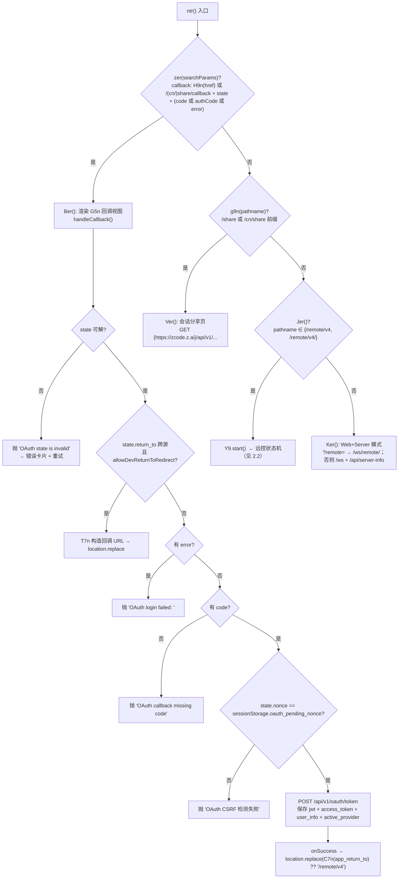
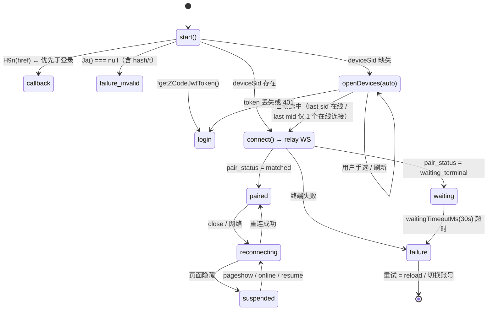
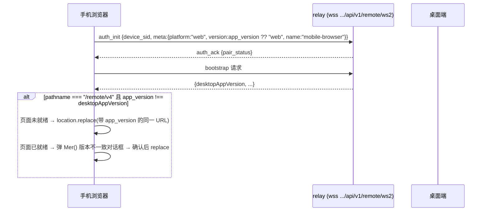

# 01 · 入口、链接参数、登录门控与路由/版本选择（ZCode Web 3.16.1）

审计对象：`E:\Zcode_android\Reference_web\3.16.1\`（主包 `assets/index-DbEHT6Gg.js` 6,836,503 B）。
辅助源：桌面端 `app.asar`（3.16.1 同发布）只读 grep，用于确认主机/服务端约定。
旧基线 `E:\Zcode_android\archive\pre-3.16.1-auth\` 未作为当前规格使用。

所有坐标格式：`文件:UTF-8字节偏移`，偏移用 `Buffer.indexOf`/`Buffer.byteLength` 计算（不是 UTF-16 索引）。

---

## 1. 结论摘要

1. **入口 HTML 是按版本渲染的静态页，不是客户端选版本。** 抓包入口 `https://zcode.z.ai/remote/v4?app_version=3.16.1` 返回 200 `text/html`，页面里所有资源写死为 `/remote/v4/3.16.1/assets/...`。版本 → assets 前缀的映射发生在**服务端**；客户端唯一的版本动作是「发现 `app_version` 与桌面端不一致就改写 URL 并整页 `location.replace`」。
2. **`hash` / `t` 在 3.16.1 网页端是「毒药参数」**：解析器 `Ja()` 一见到任一存在就返回 `null`，直接落到 `invalid-mobile-connection` 失败页——旧链接不是"降级兼容"，而是**显式拒绝**。
3. **参数只认四个**：`sid → deviceSid`、`mid → deviceMid`、`name → deviceName`、`app_version → appVersion`；取值语义是 `get(k)?.trim() || undefined`（空/纯空白 = 不存在）。**没有任何格式校验**（长度、字符集、host、scheme 全不查）。
4. **门控顺序是固定的四段**：`callback?` → `jwt?` → `parse params` → `sid?`。callback 判定优先于登录判定，所以带 `state+code` 的回调页即使没登录也先走回调视图；`sid` 缺失**不是错误**，而是「设备列表」分支。
5. **登录往返把连接参数塞进了 OAuth 的 `redirect` 查询**：`w7n()` 在 `redirectUri` 的 pathname 属于 `/remote/v4` 时，把白名单 `[app_version, sid, mid, name]` 复制到 `redirect` 上，因此授权回跳落地的 URL 自带全部连接参数；`state`（base64url JSON，**未签名**）里的 `app_return_to` 再经 `C7n()` 做同源 + 路径 + 参数三重白名单清洗后才用于 `location.replace`。
6. **每次加载都重新门控**：入口函数 `ntr()` 无条件执行；JWT 在 `localStorage`，但只要 `jwt / access_token / user_info` 任一缺失或 JWT 过期，`loadCachedSessionState()` 会 `clearAll()` 并回到登录页。`visibilitychange → visible` 还会触发设备列表刷新，若 token 变了则整体重启 `start()`。
7. **环境/域名是构建期常量，链接里没有 provider 字段**：web 包写死 `https://zcode.z.ai`（base）、`https://chat.z.ai`（Z.ai 授权）、`https://bigmodel.cn`（BigModel 授权）。provider 只在登录页二选一（`zai` / `bigmodel`），或从 `localStorage["oauth:active_provider"]` 恢复。

---

## 2. 完整流程图 / 状态机

### 2.1 进程入口（单次页面加载）



### 2.2 远控视图状态机（`K9n` 类，`start()` 为唯一入口）



### 2.3 连接建立后的版本自愈



关键：只有 **canonical `/remote/v4`** 会做这件事；`/remote/v4/3.16.1` 这类带版本前缀的 path 不触发（`h=window.location.pathname.replace(/\/+$/,"")==="/remote/v4"`）。

---

## 3. 链接参数逐字段表

解析器：`Ja(e)`（`src-uVqBd_Eq.js:51830`，`export{Ja as P}` → 主包 `import{P as mr}`）。

```js
function Ja(e){if(e.has(`hash`)||e.has(`t`))return null;let t={};
 for(let[n,r]of[[`deviceSid`,`sid`],[`deviceMid`,`mid`],[`deviceName`,`name`],[`appVersion`,`app_version`]]){
   let i=Wa(e,r);i&&(t[n]=i)}return t}
function Wa(e,t){return e.get(t)?.trim()||void 0}
```

| 名称 | 内部字段 | 类型 | 必填 | 来源 | 校验 | 去向 | 缺失/空值分支 |
|---|---|---|---|---|---|---|---|
| `sid` | `deviceSid` | string | **实质必填**（缺则进设备列表，不是报错） | 桌面端 `buildWebRemoteControlExternalQrUrl` 写入；或设备列表选中后 `replaceState` 回写 | 无（不查长度/字符集）。relay 侧 schema 才要求 1..128 字符且 ≤128 UTF-8 字节 | `auth_init.device_sid`；relay WS 无 sid 参数（sid 在帧内） | 缺失/空/纯空白 → `openDevices(true)` |
| `mid` | `deviceMid` | string | 可选 | 同上 | 无 | ① relay WS `?mid=`；② 设备分组键；③ `localStorage["zcode-web-remote-client-id:<sid>"]` 之外的命名空间 `mobile:<mid\|sid>` | 缺失 → 不加 `?mid=`，设备按 `device_sid` 独立成组 |
| `name` | `deviceName` | string | 可选 | 同上（`meta.name`） | 无 | 仅展示（"正在连接 <name>"）；不参与鉴权 | 缺失 → 展示兜底文案 `正在连接电脑` |
| `app_version` | `appVersion` | string | 可选 | 同上（桌面端自身版本） | 客户端**只做字符串相等**比较；semver 门限只在桌面端/服务端 | ① `auth_init.meta.version`（缺省 `"web"`）；② 版本自愈时与 `desktopAppVersion` 比对 | 缺失 → meta.version=`"web"`；canonical 路由下会被改写回桌面版本并 reload |
| `hash` | — | — | **禁止出现** | 旧链接（≤3.15.x） | `e.has("hash")` → 直接 `null` | — | 出现（哪怕空值 `hash=`）→ `invalid-mobile-connection` |
| `t` | — | — | **禁止出现** | 旧链接 | `e.has("t")` → 直接 `null` | — | 同上 |
| `theme` | — | — | **远控路由不读** | 旧链接可能带 | 无 | — | 被忽略（主题来自 `localStorage["zcode-theme"]`，见 `index.html:3821`） |
| `state` | — | string(base64url JSON) | 仅回调页必填 | OAuth 授权服务器回跳 | `y7n()` 解 base64url→JSON，要求 `nonce` 非空 | nonce 校验 + `app_return_to` | 缺 `state` → `parseCallbackParams` 抛 `OAuth callback missing state` |
| `code` / `authCode` | — | string | 回调页必填（二选一） | OAuth 回跳 | 非空即取，`authCode` 作为 `code` 的别名 | token 交换 | 都没有 → `OAuth callback missing code` |
| `error` | — | string | 可选 | OAuth 回跳 | 非空 | 抛 `OAuth login failed: <error>` | — |
| `remote` | — | string | 仅 Web+Server 模式 | 非远控入口 | 无 | `/ws/remote/<remote>` | 缺失 → `/ws` |
| 其他任意参数 | — | — | — | — | 不校验 | 保留在地址栏，直到 `replaceState` / 登录回跳清洗时被丢弃 | — |

### 3.1 分支细节（必须逐条记住）

| 情形 | 行为 | 证据 |
|---|---|---|
| 完全无参数（`/remote/v4`） | `Ja` 返回 `{}`（**真值**）→ `!t.deviceSid` → 设备列表 | `index-DbEHT6Gg.js:6765795` |
| `sid=` / `sid=%20%20` | `Wa` trim 后为空 → `undefined` → 设备列表 | `src-uVqBd_Eq.js:51431` |
| `sid=a&sid=b` | **首个生效**（`URLSearchParams.get` 返回第一个）→ `a` | 同上 |
| `?sid=x&hash=`（空 hash） | 拒绝（`has` 不看值） | `src-uVqBd_Eq.js:51830` |
| 任意未知参数 | 忽略，不影响解析 | `Ja` 只枚举四个键 |
| 路径不是 `/remote/v4`（如 `/remote/v4/3.16.1`） | 不算远控入口（`Jer()` 为假）→ 落到 Web+Server 模式 | `index-DbEHT6Gg.js:6811483` |
| 回调 URL 落在 `/remote/v4/3.16.1` | **不识别为回调**（`H9n` 只认 `/remote/v4` 与 `/remote/v4/`） | `index-DbEHT6Gg.js:6765087` |

### 3.2 URL 规范化

| 动作 | 实现 | 效果 |
|---|---|---|
| 选中设备后回写地址栏 | `selectDevice` → `history.replaceState(state, "", href)` | 写入 `sid`、`mid`，`name` 有则写无则删；`app_version` 保留 |
| 切换设备 | `chooseOtherDevice` → 依次 `delete` `sid,mid,name,hash,t` | 只剩 `app_version`，然后进设备列表 |
| 登录回跳清洗 | `C7n(url,{currentOrigin})` | 要求：可解析 URL、pathname ∈ `{/remote/v4,/remote/v4/,/remote/__test__,/remote/__test__/}` 或匹配 `^\/(?:cn\/share\|share)\/[A-Za-z0-9._~-]{1,512}$`、origin === 当前 origin；然后**只保留** `app_version,sid,mid,name`（按此顺序重建 query），丢弃 fragment |
| 回调 URL 构造（dev 专用） | `T7n` | 清空非 `/remote/v4` 的 query，写 `code`/`error`/`state` |

> 注意：`S7n` 按 `p7n` 的迭代顺序 `app_version → sid → mid → name` 重建，所以登录回跳后的 URL 参数顺序是被**固定重排**的。

---

## 4. 登录门控与路由分支表

### 4.1 门控判定（`start()`，`index-DbEHT6Gg.js:6765795`）

```js
async start(){ this.reset(); let e=new URL(this.options.getHref());
  if(H9n(e)){ this.options.onView({kind:`callback`}); return }              // ①
  if(!this.options.auth.getZCodeJwtToken()){ this.options.onView({kind:`login`}); return }  // ②
  let t=mr(e.searchParams);
  if(!t){ this.options.onView({kind:`failure`,failure:{reason:`invalid-mobile-connection`}}); return } // ③
  if(!t.deviceSid){ await this.openDevices(!0); return }                     // ④
  this.connect({...t,deviceSid:t.deviceSid})                                 // ⑤
}
```

| # | 条件 | 行为 | 视图 / 文案 / 错误 |
|---|---|---|---|
| ① | pathname ∈ {`/remote/v4`,`/remote/v4/`} 且 `state` 且（`code`\|`authCode`\|`error`） | 渲染回调页 `G5n`，立即 `handleCallback(href)` | 标题 `ZCode - Web Remote Control Sign In`；成功 `Finishing Sign-In`，失败 `Sign-In Failed` + 原始异常文本 + `Sign In Again` |
| ② | `getZCodeJwtToken()` 为 null（未登录 / 已过期 / 三件套不齐 / 密文坏） | 渲染登录页 `q5n`（两个按钮） | 标题 `登录后继续使用 Web 远程控制`；按钮 `连接 Z.ai 继续使用`（Global）/ `连接 BigModel 继续使用`（CN） |
| ③ | `Ja()` 返回 null（存在 `hash` 或 `t`） | 失败页 | `invalid-mobile-connection`：badge「校验失败」/ title「手机连接已失效」/ desc「当前页面的二维码参数无效，请扫描桌面端的最新二维码。」/ action「重新连接」；次级按钮「选择其他设备」→ `chooseOtherDevice()` |
| ④ | 无 `sid` | `openDevices(true)`：读 `last-device-sid/mid`，拉 `GET /api/v1/remote/device` | 设备列表页 `ker`（在线/离线分组、loading、error、empty 四态）；同一 `device_mid` 有多个在线连接时弹底部选择表 `yer` |
| ⑤ | 有 `sid` 且有 JWT | 直接 `connect()` → 建立 relay WS | 连接壳 `cer`（4 步进度条：连接中转服务→设备鉴权→等待桌面端配对→同步工作区） |

### 4.2 「已登录」的严格定义（`loadCachedSessionState`，`index-DbEHT6Gg.js:6713613`）

必须**同时**满足，否则 `clearAll()` 并视为未登录：

1. `localStorage["oauth:active_provider"]` ∈ {`zai`,`bigmodel`}；
2. `localStorage["zcodejwttoken"]` 非空；
3. `localStorage["oauth:<provider>:access_token"]` 非空；
4. `localStorage["oauth:<provider>:user_info"]` 非空且能解析出 id/username/displayName；
5. JWT 未过期（`Zi(jwt, now).kind !== "expired"`）。

→ **只有 access_token 没有 jwt 也算未登录**；**jwt 过期会顺手清掉全部凭据**（`clearAll`），不只是忽略。

### 4.3 授权请求与回跳

| 环节 | 实现 | 关键值 |
|---|---|---|
| 授权地址（zai） | `D7n` + `buildAuthorizeUrl` | `https://chat.z.ai/api/oauth/authorize?redirect_uri=<redirect>&response_type=code&client_id=client_P8X5CMWmlaRO9gyO-KSqtg&state=<b64url>` |
| 授权地址（bigmodel） | `O7n` + `buildAuthorizeUrl` | `https://bigmodel.cn/login?redirect=<redirect>&appId=zcode&state=<b64url>` |
| `state` 载荷 | `v7n` = base64url(JSON) | `{nonce, app_return_to, return_to?}`；`return_to` 仅 dev 构建存在 |
| `redirect`（= `redirect_uri`） | `w7n(config.redirectUri, appReturnTo)` | 基值 `https://zcode.z.ai/remote/v4`；若 appReturnTo 合法则**复制** `app_version,sid,mid,name` 上去，清 fragment |
| 待处理状态 | `sessionStorage` | `oauth_pending_nonce` / `oauth_pending_provider` / `oauth_pending_redirect_uri`（JSON `{nonce, redirectUri}`） |
| token 交换 | `POST /api/v1/oauth/token`，body `{provider, code, redirect_uri, state}` | `redirect_uri` 用的是**待处理的那份**（带连接参数！），不是基值 |
| 成功判据 | `Z5n` | `code === 0`、`data.token` 非空、`data.<provider>.access_token` 非空；`expires_in` 换算 `expiresAt` |
| 落盘 | `saveTokenSet` / `saveUserInfo` / `setActiveProvider` | jwt 与 access_token 分开键；user_info 原样 JSON |
| 回到远控页 | `Ber` 的 `onSuccess({appReturnTo})` | `window.location.replace(appReturnTo ?? "/remote/v4")`；`appReturnTo` 已被 `C7n` 清洗，非法/跨源 → `null` → 退回裸 `/remote/v4`（**丢失 sid/mid**，随后进设备列表） |

### 4.4 失败分类（`ner` 文案表，`index-DbEHT6Gg.js:6773150`）

| reason | 触发点 | 文案 badge / title | 主按钮 | 次按钮 |
|---|---|---|---|---|
| `device-not-owned` | relay `AUTH_FAILED` | 账号不匹配 / 该设备不属于当前账号 | 切换账号（`switchAccount`） | 选择其他设备 |
| `invalid-mobile-connection` | `Ja()===null`；relay `WRONG_PARAM` | 校验失败 / 手机连接已失效 | 重新连接（reload） | 选择其他设备 |
| `session-not-found` | 终端失败原因 | 链接不可用 / 访问链接已失效 | 重新加载 | — |
| `session-expired` | 同上 | 会话结束 / 本次远程控制已结束 | 重新加载 | — |
| `session-conflict` | relay `KICKED`（重试耗尽） | 设备接管 / 已被其他设备接管 | 重新连接 | — |
| `workspace-closed` | 桌面端无可用工作区 | 工作区关闭 / 当前工作区已关闭 | 重新加载 | — |
| `desktop-disconnected` | `DEVICE_OFFLINE` 超过 15s 宽限；waiting 超时 | 电脑端离线 / 桌面端已离线 | 重新连接 | — |
| `desktop-bootstrap-timeout` | bootstrap 超时 | 响应超时 / 桌面端响应超时 | 重试 | — |
| `connection-recovery-timeout` | 恢复超时 | 恢复超时 | 重试 | — |
| `relay-unavailable` | 非 2xx / 非 JSON / 网络异常（`auth-required` 在此表被**降级映射**成 `relay-unavailable`） | 中转异常 / 无法连接中转服务 | 重试 | — |
| `unsupported-action` | 无 | 暂不支持 | 重新加载 | — |
| `unexpected-error` | 兜底 | 未知异常 / Web 远程控制失败 | 重试 | — |

> `rer()` 的存在说明：视图层的 `auth-required` 不会显示"需要登录"，而是显示"中转异常"。真正的重新登录入口是 `device-not-owned → switchAccount`，以及 `connect` 的 `onFailure.reason === "auth-required" → switchAccount`。

### 4.5 重载 / 刷新 / 深链返回是否重新门控

| 事件 | 是否重新门控 | 依据 |
|---|---|---|
| 整页加载 / 硬刷新 | **是**（`ntr()` → `Y9.start()`） | `index-DbEHT6Gg.js:6830751` |
| 浏览器后退/前进到该页（bfcache `pageshow`） | **否**：走 `q9n` 的 `onRecover` → `recoverInBackground()`，只重连传输，不重跑 `start()`、不重判 JWT | `index-DbEHT6Gg.js:6769319`（`q9n`）+ `:6821764`（装配） |
| 标签页重新可见 | 条件性：`refreshDevices()` 发现 `acceptedJwt !== getZCodeJwtToken()` → `start()`；token 为空 → `switchAccount()`（logout + 登录页） | `subscribeVisible` |
| 登录回跳 | 是（`Ber` 整页 `replace`，等于重新加载 → `start()`） | `index-DbEHT6Gg.js:6803876` |
| 切换设备 | 否（同一页内 `replaceState` + 重连） | `chooseOtherDevice` |

### 4.6 持久化清单

| 存储 | 键 | 内容 | 清理时机 |
|---|---|---|---|
| localStorage | `oauth:active_provider` | `zai` / `bigmodel` | `logout()` / `clearAll()` |
| localStorage | `zcodejwttoken` | JWT | 同上；JWT 过期时也会被清 |
| localStorage | `oauth:zai:access_token` / `oauth:zai:user_info` | Z.ai 凭据 + 原始 user JSON | 同上 |
| localStorage | `oauth:bigmodel:access_token` / `oauth:bigmodel:user_info` | BigModel 凭据 | 同上 |
| localStorage | `zcode-web-remote-last-device-sid` / `-mid` | 上次连接的设备（自动重连用） | 只在 `chooseOtherDevice` 之后的列表流程里被消费并置空 |
| localStorage | `zcode-web-remote-device-names` | `[[mid, name, platform?], ...]`，上限 50 条 | 覆盖写 |
| localStorage | `zcode-web-remote-client-id:<sid>` | 每设备一个稳定 client id（randomUUID） | 不清理 |
| localStorage | `zcode-theme` | 主题（`index.html` 首屏也读它） | 用户改主题时 |
| sessionStorage | `oauth_pending_nonce` / `oauth_pending_provider` / `oauth_pending_redirect_uri` | OAuth 往返状态 | 回调成功后立即清 |
| sessionStorage | `zcode:web-remote-control:bootstrap-shell` | 跨 workspace 跳转的首屏快照（主题/背景色） | `index.html` 读到即删 |
| URL | `app_version` / `sid` / `mid` / `name` | 连接参数 | `replaceState` 改写 / 登录回跳清洗 |

---

## 5. 域名 / 环境 / 版本选择表

### 5.1 域名常量（`validation-BBf1FA1a.js:123467`）

| 常量 | 值 | 用途 |
|---|---|---|
| `Sd` | `https://zcode.z.ai` | ZCode 生产 base |
| `Cd` | `https://zcode.chatglm.site` | ZCode 测试 base |
| `wd` | `https://bigmodel.cn` | BigModel 生产 API base |
| `Td` | `https://dev.bigmodel.cn` | BigModel 测试 API base |
| （主包内联） | `https://chat.z.ai` | Z.ai OAuth 授权页 origin（`VITE_ZAI_OAUTH_ORIGIN`） |
| （主包内联） | `https://bigmodel.cn` | BigModel 授权页 origin（`VITE_BIGMODEL_OAUTH_ORIGIN`） |

### 5.2 环境选择

```js
function Nd(e={}){return e.ZCODE_ENV?.trim().toLowerCase()===`test`?`test`:`production`}
function Md(e){let t=e?.env??`test`, n=e?.envBaseOrigin?.trim();
  if(t===`production`) return n?kd(n):Sd;
  let r=e?.overrideOrigin?.trim(); return r?kd(r):n?kd(n):Cd}
```

| 输入 | 结果 |
|---|---|
| `ZCODE_ENV=test` | base = `https://zcode.chatglm.site`（可被 `overrideOrigin`/`envBaseOrigin` 覆盖） |
| 未设置 / 其他值 | base = `https://zcode.z.ai` |
| `env` 缺省（`Md` 内部） | **`test`**（注意：与 `Nd` 的默认相反，靠 `Pd` 显式传入 `Nd` 结果来兜住） |

**web 远控包不读运行时环境变量**：`R9 = k7n({...})` 里的 `VITE_*` 全是构建期字面量，没有 `ZCODE_ENV` 分支。`ZCODE_ENV` 在 web 包里只出现在设置/登录 schema 中（与远控路由无关）。

### 5.3 API / WS 端点

| 端点 | 值 | 证据 |
|---|---|---|
| 设备列表 | `GET {origin}/api/v1/remote/device` | `src-uVqBd_Eq.js:53637` |
| 设备注册 | `POST {origin}/api/v1/remote/device` | 同上 |
| 设备删除 | `POST {origin}/api/v1/remote/device/delete` | 同上 |
| relay token | `POST {origin}/api/v1/remote/token`，body `{role:"terminal"}` | 同上 + `index-DbEHT6Gg.js:6762730` |
| relay WS | `wss://{host}/api/v1/remote/ws2` | `validation-BBf1FA1a.js:125195`（`Id`） |
| OAuth token | `/api/v1/oauth/token`（相对 origin） | `index-DbEHT6Gg.js:6718170` |
| 授权页 | `{chat.z.ai}/api/oauth/authorize`；`{bigmodel.cn}/login` | `index-DbEHT6Gg.js:6717798` / `:6717881` |
| 分享 API | `{https://zcode.z.ai}/api/v1`（`Ver()` 内硬编码） | `index-DbEHT6Gg.js:6804205` |

### 5.4 版本选择（v3 / v4）

```js
var Ed=`3.4.0`;
function Dd(e){ /* 严格 semver 解析，比较 major.minor.patch */
  ... for(...) if(o[e]!==s[e]) return o[e]>s[e]; return n===void 0 }   // n = prerelease 段
function Vd(e,t={}){ ... a=Dd(t.appVersion)?`v4`:`v3`;
  return {remoteUrl:`${origin}/remote/${a}`, webRemoteCallbackUrl:`${origin}/remote/v4`, ...} }
```

| `app_version` | `remoteUrl` |
|---|---|
| 缺失 / 空 | **`v3`**（`Dd(undefined) === false`） |
| 非法（`3.16`、`abc`、`03.1.0`） | **`v3`** |
| `< 3.4.0`（如 `3.3.9`） | `v3` |
| `>= 3.4.0` 正式版（`3.4.0`、`3.16.1`） | `v4` |
| `3.4.0-beta.1` 之类的预发布 | `v3`（相等时 `return prerelease === undefined` → false） |

桌面端用**自身** `appVersion` 生成二维码基址（`/remote/v4`），随后 `qpe` 再追加 `app_version`。web 客户端**不做** semver 判断，只做字符串相等比较用于版本自愈。

### 5.5 版本与 assets 前缀

| 事实 | 证据 |
|---|---|
| 入口 HTML 的 `<script>`/`modulepreload`/CSS 全部写死 `/remote/v4/3.16.1/assets/...` | `index.html:10685` |
| 抓取入口 = `https://zcode.z.ai/remote/v4?app_version=3.16.1`，返回 `text/html` 18357 B | `_manifest.json` → `entryUrl`，及 `records` 中 `file:"index.html"` 那条 |
| 抓取器记录的 `assetPrefix = /remote/v4/3.16.1/`、`deploymentVersion = 3.16.1` | `_manifest.json` |
| 客户端不会请求别的版本 HTML，只在 `app_version` 不符时整页 replace | `index-DbEHT6Gg.js:6771185`（`Q9n`）+ `:6818946`（gate） |

→ 结论：**`app_version` 是服务端渲染版本选择器的输入**；`assets` 前缀是该选择的产物。`app_version` 缺失/非法时服务端回落到哪个版本 —— `UNVERIFIED`（快照只能证明"给了 3.16.1 就返回 3.16.1 的 HTML"）。

### 5.6 provider 探测

**不存在**链接内的 provider 字段，也没有自动探测。provider 只在两处决定：

1. 登录页按钮（`zai` / `bigmodel`）→ `startLogin(provider)` → `savePendingProvider` → token 交换时回传；
2. `localStorage["oauth:active_provider"]` → 决定读哪一组 `access_token` / `user_info`（API 调用用），以及展示"当前账号"。

---

## 6. 与当前 Rust / Kotlin 的差异清单

读取的文件（未修改）：
- `E:\Zcode_android\android\app\src\main\kotlin\app\zemote\pairing\PairingUrl.kt`（注意：实际路径是 `pairing/`，不是 `ui/pairing/`）
- `E:\Zcode_android\android\app\src\main\kotlin\app\zemote\ui\pairing\PairingViewModel.kt`
- `E:\Zcode_android\android\app\src\main\kotlin\app\zemote\data\AuthStore.kt`
- `E:\Zcode_android\android\app\src\main\kotlin\app\zemote\ui\auth\LoginViewModel.kt`
- `E:\Zcode_android\rust\crates\protocol\src\connection_params.rs`
- 参考：`android/app/src/main/kotlin/app/zemote/auth/OAuth.kt`

### 6.1 字段 / 分支差异

| # | 维度 | Web 3.16.1 行为 | 当前 Rust | 当前 Kotlin | 判定 |
|---|---|---|---|---|---|
| D1 | 旧参数 `hash`/`t` | **存在即拒绝**（`invalid-mobile-connection`） | 接受：`pass_hash: Option`、`timestamp: Option`；`t` 存在则必须可解析为整数 | `preflight` 放行；`hasPassHash` 非空时允许不登录直连 | **CONFIRMED 差异**（Web 更严，且是硬拒绝） |
| D2 | 重复参数优先级 | **首个胜**（`URLSearchParams.get`） | **后者胜**（`split_query_string` 用 `HashMap::insert`，文件内已自述） | **后者胜**（`queryParams` 用 `map[key]=`） | **CONFIRMED 差异** |
| D3 | scheme 校验 | 不校验（页面本身已在 https） | 仅 `https`/`wss` | `http`/`https`/`wss`（有意放宽为超集） | CONFIRMED（Kotlin 是有意超集，Rust 与 Web 语义不可比） |
| D4 | host 校验 | 不校验 | 不校验（空 host 也收） | 空 host 拒绝（`MISSING_HOST`，有意收紧） | CONFIRMED（Kotlin 更严） |
| D5 | `theme` | 远控路由**不读** URL 的 `theme`；主题来自 `localStorage["zcode-theme"]` | 解析并保存 `theme`，经 FFI 透出，未参与行为 | 不解析 | **CONFIRMED 差异**（Rust 多了一个 Web 不存在的输入） |
| D6 | `t` 的数字校验 | 无关（直接拒绝 `t`） | 有（`parse_int_like_dart`，支持 `+`/`-`/`0x`） | 无（不解析 `t`） | CONFIRMED（随 D1 一起变得多余） |
| D7 | `sid` 必填语义 | 缺 `sid` **不是错误**，是「设备列表」分支 | `parse` 返回 `None`（缺 `sid` = 非法链接） | `MISSING_SID` 拒绝 | **CONFIRMED 差异（语义级）**：Web 把"无 sid"当正常路径，两端当非法 |
| D8 | `app_version` 用途 | ① `auth_init.meta.version`（缺省 `"web"`）② 与 `desktopAppVersion` 比对触发整页 reload | ① 同（`relay_client.rs:340`，缺省 `"web"`）；② **无版本自愈** | 不读取、不透传 | Web/Rust 一致；Kotlin 缺失 |
| D9 | 登录门控条件 | **一律**要 JWT（不存在无登录直连路径） | `auth_token: Option`，由宿主注入；无 token 时走 legacy `/ws` + HMAC | `token == null && !hasPassHash(url)` 才要求登录 | **CONFIRMED 差异**（Kotlin 保留了 Web 已删除的 hash 直连） |
| D10 | relay WS 路径 | 只有 `wss://host/api/v1/remote/ws2?token=&mid=` | token 模式 `/api/v1/remote/ws2`；legacy `/ws` | 只有 ws2 | Rust 多一条 Web 不存在的 legacy 路径（与 D1/D9 同源） |
| D11 | 设备列表 / 自动重连 | 有：`GET /api/v1/remote/device` + `last-device-sid/mid` 自动选中 + 同 mid 多连接底部选择 | 无 | 无（只有 `POST /api/v1/remote/token`） | **CONFIRMED 缺失**（Kotlin 无 sid 时无法恢复，只能重扫码） |
| D12 | 登录回跳参数保留 | `redirect` 上带 `app_version/sid/mid/name`，回跳后参数自动恢复 | 不涉及（宿主注入 token） | `OAuthConfig.REDIRECT_URI` 是常量 `https://zcode.z.ai/remote/v4`，不带参数；`state` 里 `app_return_to` 传的是 redirectUri | **CONFIRMED 差异**（Kotlin 靠 `pendingUrl` 在内存里记住，页面/进程重建即丢） |
| D13 | `state` 校验 | base64url JSON，未签名；nonce 存 sessionStorage 并与 `state.nonce` 严格相等 | 不涉及 | 同样 base64url JSON，nonce **只在内存**（`OAuthRequest.nonce`） | 语义等价（`CONFIRMED`），但持久化位置不同（刷新页面后 Web 仍能完成回调，Kotlin 不能） |
| D14 | 失败分类 | 12 个结构化 `reason` + 独立文案表 + 每类动作 | `ProtocolError` / 字符串 | `PairingUiState.error` 收敛文案 + `needsLogin` 布尔 | CONFIRMED（Kotlin 无结构化 reason，无法表达"账号不匹配→切换账号"这类分支） |
| D15 | `name` 用途 | 仅展示 | 保存 | `PairingUrl.deviceLabel` 作默认显示名 | 一致 |
| D16 | 空值处理 | `trim()` 后空 = 不存在 | `get_param` 同样 | 同样 | 一致（CONFIRMED） |
| D17 | `mid` 用途 | 设备分组 + relay `?mid=` + 命名空间 | relay `?mid=` | relay `?mid=` | 一致 |
| D18 | 版本自愈 | 有（`Q9n` + `Mer` 对话框） | 无 | 无 | CONFIRMED 缺失 |
| D19 | `device-not-owned` 处理 | 失败页 → 切换账号 | 无对应语义 | `RemoteTokenException.authRequired` → `authStore.clear()` + `needsLogin` | 部分等价（SPECULATION：relay 的 `AUTH_FAILED` 是否等价于 `device-not-owned`，未在 relay 侧验证） |
| D20 | 回调路径判定 | 严格 `/remote/v4` 或 `/remote/v4/`（带版本前缀不算） | 不涉及 | `OAuthFlow.isCallback(url, redirectUri)` 与常量 redirectUri 比对 | 一致（CONFIRMED） |

### 6.2 顺序差异（最容易被忽略的一类）

| # | 环节 | Web | 当前实现 | 影响 |
|---|---|---|---|---|
| O1 | 门控顺序 | callback → login → params → sid → connect | Kotlin：`preflight`（含 sid）→ token/hash → connect。**参数合法性先于登录** | 旧链接（带 hash）在 Web 会先要求登录再报 invalid；Kotlin 会先报 invalid 或直接连 |
| O2 | `sid` 缺失 | 落到设备列表（需要登录） | Kotlin 直接 `MISSING_SID` 拒绝 | 用户拿到"无 sid"的入口（如桌面端只给域名）时体验完全不同 |
| O3 | 登录完成后的续跑 | 整页 `location.replace` → 重新 `start()`，参数从 URL 恢复 | Kotlin `onLoginReturn()` 用内存里的 `pendingUrl` 续跑 | 进程被杀 / 页面重建后 Kotlin 丢失上下文 |
| O4 | token 过期处理 | 读凭据时**顺手清空全部**（`clearAll`） | Kotlin `token()` 只返回 null（`expiresAt` 过期不清盘），`AuthStore` 保留密文 | Kotlin 的"过期"可自愈（续期后仍可用），Web 不可（必须重新登录）。差异方向：Kotlin 更宽松 |
| O5 | 连接参数注入点 | 客户端从 URL 读，直接进 `auth_init` | Rust 从 URL 读，Kotlin 再注入 `auth_token` | 结构一致 |

### 6.3 需注意的"看似差异但实际一致"

- `relay_ws_uri` 的 query 顺序（`token` 再 `mid`）与 Web 的 `searchParams.set("token")` → `set("mid")` 一致（CONFIRMED）。
- `auth_init` 的 `meta`：`{platform:"web", version: appVersion ?? "web", name:"mobile-browser"}`，Rust 侧同名回落一致（`relay_client.rs:340`，CONFIRMED）。
- `oauth` 授权 URL 的两个分支（zai 用 `redirect_uri`+`client_id`，bigmodel 用 `redirect`+`appId=zcode`）在 Kotlin `OAuthFlow` 中完全一致（CONFIRMED）。

---

## 7. 证据索引

> 说明：下表「片段」列是从压缩产物里**逐字**抄出的，产物自身大量使用反引号（模板字符串/字面量），因此单元格内的反引号是证据的一部分，Markdown 的行内代码渲染可能被内层反引号截断——请以原文为准，不要据此改写片段。

### 7.1 入口 HTML

| 结论 | 文件 | 字节偏移 | 片段（≤200 字符） |
|---|---|---|---|
| 资源前缀写死版本 | `index.html` | 10685 | `/remote/v4/3.16.1/assets/index-DbEHT6Gg.js"></script>` |
| 首屏主题读 localStorage | `index.html` | 3821 | `const STORAGE_KEY = "zcode-theme";` / `const DEFAULT_THEME = "zai-dark";` |
| 抓取入口 | `_manifest.json` | — | `"entryUrl":"https://zcode.z.ai/remote/v4?app_version=3.16.1"`、`"assetPrefix":"/remote/v4/3.16.1/"` |

### 7.2 主包（`assets/index-DbEHT6Gg.js`）

| 结论 | 字节偏移 | 片段 |
|---|---|---|
| 远控路由集合 `F9` | 6715552 | `new Set([`/remote/v4`,`/remote/v4/`]),u7n=new Set([...F9,`/remote/__test__`,...]),d7n=new Set([...F9,`/cn/share/callback`,`/share/callback`])` |
| 分享路径正则 `f7n` | 6715710 | `f7n=/^\/(?:cn\/share\|share)\/[A-Za-z0-9._~-]{1,512}$/u` |
| 参数白名单 `p7n` | 6715769 | `new Set([`app_version`,`sid`,`mid`,`name`])` |
| 私网 host 正则 `m7n` | 6715813 | `m7n=/^https?:\/\/(localhost\|127\.0\.0\.1\|10\.\d+...\|192\.168\.\d+\.\d+)(:\d+)?(\/$\|)/` |
| origin 兜底 `h7n` | 6715940 | `function h7n(){return(globalThis.window?.location??globalThis.location)?.origin??l7n}` |
| base64url 编码 `g7n`/`v7n` | 6716085 / 6716473 | `btoa(n).replace(/\+/g,`-`).replace(/\//g,`_`).replace(/=+$/,``)` |
| state 解码 `y7n` | 6716519 | `{nonce:t.nonce,...I9(t.app_return_to)?{app_return_to:t.app_return_to}:{},...I9(t.return_to)?{return_to:t.return_to}:{}}` |
| URL 解析 `L9` | 6716727 | `function L9(e){if(!I9(e))return null;try{return new URL(e)}catch{return null}}` |
| 白名单复制 `S7n` | 6716909 | `for(let n of p7n){let r=e.get(n);r!==null&&t.set(n,r)}` |
| **清洗 `C7n`** | 6717014 | `if(!n\|\|!u7n.has(n.pathname)&&!f7n.test(n.pathname))return null;...if(n.origin!==r)return null;...return`${n.pathname}${i?`?${i}`:``}`` |
| **redirect 合并 `w7n`** | 6717288 | `!r\|\|!F9.has(r.pathname)\|\|!i\|\|!u7n.has(i.pathname)\|\|!C7n(t,n)?e:(r.search=S7n(i.searchParams).toString(),r.hash=``,r.toString())` |
| 回调 URL 构造 `T7n` | 6717465 | `n.search=F9.has(n.pathname)?S7n(n.searchParams).toString():``,n.hash=``,I9(t.code)&&n.searchParams.set(`code`,t.code)...` |
| 授权页 `D7n` | 6717798 | ``return`${E7n(e?.trim()\|\|`https://chat.z.ai`)}/api/oauth/authorize` `` |
| BigModel 登录页 `O7n` | 6717881 | ``return`${t?new URL(t).origin:At({})}/login` `` |
| 配置工厂 `k7n` | 6717957 | `n=a(e.VITE_ZCODE_BASE_URL?.trim()\|\|e.VITE_ZCODE_ENDPOINT_ORIGIN?.trim()\|\|`https://zcode.z.ai`)` |
| tokenUrl / clientId / appId | 6718170 / 6718201 / 6718278 | `tokenUrl:`/api/v1/oauth/token``、`client_P8X5CMWmlaRO9gyO-KSqtg`、`bigmodelAppId:...\|\|`zcode`` |
| **烘焙配置 `R9`** | 6718566 | `R9=k7n({BASE_URL:`/remote/v4/3.16.1/`,DEV:!1,MODE:`production`,PROD:!0,...,VITE_WEB_REMOTE_CONTROL_ROUTE_PATH:`/remote/v4`,VITE_ZAI_OAUTH_ORIGIN:`https://chat.z.ai`,VITE_ZCODE_BASE_URL:`https://zcode.z.ai`})` |
| dev 回跳 `A7n` | 6718931 | `return e.devOrigin?`${e.devOrigin}/${t===`share`?`share/callback`:`remote/v4`}`:void 0` |
| nonce 生成 `j7n` | 6719045 | `if(globalThis.crypto?.randomUUID)return globalThis.crypto.randomUUID()` |
| 运行时 `M7n` | 6719348 | `{assign:e=>{window.location.assign(e)},createNonce:j7n,getCurrentHref:...,replace:e=>{window.location.replace(e)}}` |
| **auth service `N7n`** | 6719549 | `var N7n=class{config;provider;repo;runtime;constructor(e={}){this.config=e.config??R9,...}` |
| **startLogin** | 6719738 | `let t=this.runtime.createNonce(),n=e.provider??`zai`,r=e.appReturnTo??this.runtime.getCurrentHref()...a=w7n(e.redirectUri??this.config.redirectUri,r,i)` |
| **handleCallback** | 6720237 | `let t=this.provider.parseCallbackParams(e),n=y7n(t.state);if(!n)throw Error(`OAuth state is invalid`)` |
| CSRF 检查 | 6720765 | `if(n.nonce!==i)throw Error(`OAuth CSRF 检测失败`)` |
| 回跳返回值 | 6721368 | `{userInfo:c.userInfo,appReturnTo:C7n(n.app_return_to,{currentOrigin:this.runtime.getCurrentOrigin()})}` |
| provider 类 `Q5n` | 6710908 | `var Q5n=class{constructor(e,t=Date.now){this.config=e,this.now=t}buildAuthorizeUrl(e){...}` |
| 授权 URL 分支 | 6710973 | `if(e.provider===`bigmodel`){let n=new URLSearchParams({redirect:t,appId:this.config.bigmodelAppId,state:e.state})...}` |
| 回调解析 | 6711375 | `let n=t.searchParams.get(`state`)?.trim();if(!n)throw Error(`OAuth callback missing state`)` |
| token 交换 | 6711731 | `body:JSON.stringify({provider:t,code:e.code,redirect_uri:e.redirectUri??this.config.redirectUri,state:e.state})` |
| 存储键 | 6712103 / 6712266 | `oauth:active_provider`、`zcodejwttoken`、`oauth:zai:access_token`、`oauth_pending_nonce`、`oauth_pending_redirect_uri` |
| 凭据仓库 `c7n` | 6712655 | `var c7n=class{localStorage;sessionStorage;now;constructor(e=s7n(),t={}){...}` |
| **会话有效性** | 6713613 | `if(!n\|\|!P9(t)\|\|!P9(r)\|\|!P9(i))return this.hasAnyStoredCredential()&&this.clearAll(),{status:`signed-out`};if(Zi(t,this.now()).kind===`expired`)return this.clearAll(),{status:`reauthentication-required`...}` |
| JWT 取值 | 6714174 | `loadZCodeJwtToken(){return this.loadCachedSessionState().status===`authenticated`&&this.localStorage.getItem(M9)?.trim()\|\|null}` |
| pending redirect 存储 | 6715107 | `savePendingRedirectUri(e,t){this.sessionStorage.setItem(a7n,JSON.stringify({nonce:e,redirectUri:t}))}` |
| 设备列表 API | 6747754 | `new URL(Er.list.path,e),{method:`GET`,headers:{Authorization:`Bearer ${n}`}...}` |
| relay token API | 6762730 | `new URL(Er.token.path,e),{method:`POST`,...body:JSON.stringify({role:`terminal`})...}` |
| **auth_init 帧** | 6751450 | `this.send({type:`auth_init`,device_sid:this.options.deviceSid,meta:{platform:`web`,version:this.options.appVersion??`web`,name:`mobile-browser`},client_ts:...})` |
| pair_status 处理 | 6755327 | `if(cee(e)===`waiting_terminal`){...}if(e===`matched`){...this.setState(`paired`),this.wasPaired=!0...}` |
| relay 错误映射 | 6756293 / 6756574 | `if(e===`KICKED`){...}`；`this.enterTerminalFailure(H9(e===`AUTH_FAILED`?`device-not-owned`:`invalid-mobile-connection`))` |
| 终端失败 | 6760849 | `enterTerminalFailure(e){this.intentionallyClosed=!0,...this.setState(e.reason===`session-conflict`?`kicked`:`error`)...}` |
| 设备名缓存键 | 6764221 | `R9n=`zcode-web-remote-device-names`` |
| **回调判定 `H9n`** | 6765087 | `[`/remote/v4`,`/remote/v4/`].includes(e.pathname)&&e.searchParams.has(`state`)&&(e.searchParams.has(`code`)\|\|e.searchParams.has(`authCode`)\|\|e.searchParams.has(`error`))` |
| last-device 键 | 6765279 | `U9n=`zcode-web-remote-last-device-sid`,W9n=`zcode-web-remote-last-device-mid`` |
| **自动选中 `G9n`** | 6765361 | `if(!n&&!r)return;let i=n?e.find(e=>e.device_sid===n):void 0;if(i?.online)return i.device_sid;...return o.length===1?o[0]?.device_sid:void 0` |
| 视图模型 `K9n` | 6765595 | `var K9n=class{scope=new AbortController;list;constructor(e){this.options=e}...` |
| **门控 `start()`** | 6765795 | `if(H9n(e)){onView callback}if(!auth.getZCodeJwtToken()){onView login}let t=mr(e.searchParams);if(!t){onView failure invalid-mobile-connection}if(!t.deviceSid){await this.openDevices(!0);return}this.connect({...t,deviceSid:t.deviceSid})` |
| 设备列表加载 | 6766218 | `e&&(t=this.options.storage.getItem(U9n),n=...W9n)...e.view={...e.view,devices:a,loading:!1,error:!1};let o=G9n(r,a,e.lastSid,e.lastMid)` |
| 选中设备 | 6767630 | `n.searchParams.set(`sid`,t.device_sid),n.searchParams.set(`mid`,t.device_mid);let r=t.meta.name?.trim();r?n.searchParams.set(`name`,r):n.searchParams.delete(`name`),this.options.replaceHref(n.href)...appVersion:n.searchParams.get(`app_version`)\|\|void 0` |
| 切换设备 | 6768317 | `for(let t of[`sid`,`mid`,`name`,`hash`,`t`])e.searchParams.delete(t)` |
| 连接 | 6768630 | `connect(e){...getToken:e=>{let t=this.options.auth.getZCodeJwtToken();return t?this.options.token(t,e):Promise.reject(new In(`auth-required`))}...onFailure:e=>{...e.reason===`auth-required`?this.switchAccount():...}}` |
| 视图层登录 | 6769046 | `startLogin(e){this.options.auth.startLogin({...this.options.loginOptions,...e?{provider:e}:{},appReturnTo:this.options.getHref()})}` |
| 切换账号 | 6769177 | `await this.options.auth.logout(),e.aborted\|\|this.options.onView({kind:`login`})` |
| 路由归一 `J9n` | 6770018 | `let t=e.VITE_WEB_REMOTE_CONTROL_ROUTE_PATH?.trim();return qn(t\|\|e.BASE_URL)` |
| **版本自愈 `Q9n`** | 6771185 | `let s=a.desktopAppVersion?.trim();if(s){let t=new URL(e.getUrl());if(t.pathname.replace(/\/+$/,``)===`/remote/v4`&&t.searchParams.get(`app_version`)!==s){t.searchParams.set(`app_version`,s),r=t.toString(),e.isPageReady()?e.onMismatch(s):o();return}}` |
| 失败文案表 `ner` | 6773146 | `ner={"zh-CN":{"device-not-owned":{...},"invalid-mobile-connection":{tone:`warning`,badge:`校验失败`,title:`手机连接已失效`,description:`当前页面的二维码参数无效，请扫描桌面端的最新二维码。`...}` |
| 失败映射 `rer` | 6781931 | `let n=e.reason===`auth-required`?`relay-unavailable`:e.reason;return ner[t][n]` |
| 连接壳文案 `aer` | 6782279 | `steps:[`连接中转服务`,`设备鉴权`,`等待桌面端配对`,`同步工作区`]` |
| 阶段索引 `oer` | 6783585 | `oer={idle:0,connecting:0,authenticating:1,waiting:2,paired:3}` |
| 多连接选择表 `ver` | 6788226 | `children:e.onlineConnections.map((o,s)=>...onClick:()=>i(o.device_sid)...)` |
| 底部选择表 `yer` | 6789012 | `function yer({device:e,locale:t,disabled:n,now:r,onClose:i,onSelect:a})` |
| 设备列表页 `ker` | 6794937 | `let p=e=>{let[t,...r]=e.onlineConnections;t&&(r.length===0?n(t.device_sid):c(e.deviceMid))}` |
| 版本不一致对话框 `Mer` | 6800195 | `function Mer(e,t){let n=document.createElement(`dialog`)...` |
| auth 单例 `q9` | 6803204 | `q9=P7n(),J9=!1` |
| 失败渲染 `Rer` | 6803281 | `primaryActionLabel:e.reason===`device-not-owned`?$er()?`切换账号`:`Switch account`:void 0,secondaryAction:Jer()?{label:...,onClick:()=>{Y9.chooseOtherDevice()}}:void 0` |
| 回调/分享判定 `zer` | 6803673 | `return H9n(new URL(window.location.href))\|\|[`/cn/share/callback`,`/share/callback`].includes(window.location.pathname)&&e.has(`state`)&&(e.has(`code`)\|\|e.has(`authCode`)\|\|e.has(`error`))` |
| **回调完成 `Ber`** | 6803876 | `let e=C7n(y7n(new URLSearchParams(window.location.search).get(`state`)??``)?.app_return_to);K9.render((0,$.jsx)(G5n,{authService:q9,onSuccess:({appReturnTo:e})=>{window.location.replace(e??`/remote/v4`)},onRetry:()=>{window.location.replace(e??`/remote/v4`)}}))` |
| 分享页 `Ver` | 6804205 | `let n=`https://zcode.z.ai`?.trim().replace(/\/+$/u,``)\|\|window.location.origin;...new K7n({baseUrl:`${n}/api/v1`})` |
| 登录页渲染 `Her` | 6805086 | `function Her(){document.title=`ZCode - Web Remote Control Sign In`,K9.render((0,$.jsx)(q5n,{onLogin:e=>Y9.startLogin(e)}))}` |
| 视图模型接线 `Y9` | 6805309 | `Y9=new K9n({auth:q9,getHref:...,replaceHref:e=>window.history.replaceState(window.history.state,``,e),storage:Uer,devices:E9n(window.location.origin),...onView:e=>{e.kind===`callback`?Ber():e.kind===`login`?Her():e.kind===`devices`?...:e.kind===`failure`&&Rer(e.failure)}})` |
| Web+Server ws | 6810884 / 6810984 | `Ger()` → `` `${protocol}//${host}` ``；`Ker()` → `?remote=<id>` → `/ws/remote/<id>`，否则 `/ws` + `/api/server-info` |
| **远控路由判定 `Jer`** | 6811483 | `return cr(window.location.pathname,`/remote/v4`)\|\|cr(window.location.pathname,J9n({...VITE_WEB_REMOTE_CONTROL_ROUTE_PATH:`/remote/v4`...}))` |
| 每设备 client id | 6812038 | `let t=`zcode-web-remote-client-id:${e}`...globalThis.localStorage?.setItem(t,n)` |
| relay WS 基址 `Qer` | 6818346 | `function Qer(){return Wt({endpointOrigin:window.location.origin})}` |
| 连接壳渲染 `etr` | 6818467 | `document.title=`ZCode - Web Remote Control`,K9.render((0,$.jsx)(cer,{state:e,...}))` |
| 连接装配 `ttr` | 6818604 | `Yer(t.deviceSid);let r={name:t.deviceName,platform:t.deviceMid?B9n(Uer).get(t.deviceMid)?.platform:void 0}` |
| 版本自愈 gate | 6818946 | `h=window.location.pathname.replace(/\/+$/,``)===`/remote/v4`` |
| relay 传输装配 | 6821764 | `te=new M9n({relayWsUrl:Qer(),deviceSid:t.deviceSid,deviceMid:t.deviceMid,appVersion:t.appVersion,getToken:n,...})` |
| **进程入口 `ntr`** | 6830751 | `let e=new URLSearchParams(window.location.search);if((Jer()\|\|H9n(new URL(window.location.href)))&&(document.documentElement.lang=G9(navigator.language)),zer(e)){Ber();return}if(g9n(window.location.pathname)){await Ver();return}if(Jer()){await Y9.start();return}` |

\* 已按 `Buffer.byteLength` 复算（该段之前的复制表含大量中文，UTF-16 索引与字节偏移相差约 118k，不能用 `indexOf` 的返回值直接当偏移）。

### 7.3 共享 chunk（`assets/src-uVqBd_Eq.js`）

| 结论 | 字节偏移 | 片段 |
|---|---|---|
| 取值语义 `Wa` | 51431 | `function Wa(e,t){return e.get(t)?.trim()\|\|void 0}` |
| theme 白名单 `Ga` | 51480 | `return e===`light`\|\|e===`dark`\|\|e===`zai-light`\|\|e===`zai-dark`\|\|e===`system`` |
| 路由归一 `Ka` | 51573 | `let r=n.replace(/\/+$/,``)\|\|`/`;return r===`/`?`/remote`:r` |
| 路径比较 `qa` | 51759 | `let n=e=>e.replace(/\/+$/,``)\|\|`/`;return n(e)===n(t)` |
| **参数解析 `Ja`** | 51830 | `if(e.has(`hash`)\|\|e.has(`t`))return null;...[[`deviceSid`,`sid`],[`deviceMid`,`mid`],[`deviceName`,`name`],[`appVersion`,`app_version`]]...` |
| API 路径表 `io` | 53637 | `{register:{method:`POST`,path:`/api/v1/remote/device`},list:{method:`GET`,path:`/api/v1/remote/device`},delete:{method:`POST`,path:`/api/v1/remote/device/delete`},token:{method:`POST`,path:`/api/v1/remote/token`}}` |
| provider 常量 | 30662 | `hr=`bigmodel` ` |
| 导出映射（`mr`=`Ja`） | 69537 | `Ja as P` |
| 导出映射（`Lr`=`hr`=`bigmodel`） | 69736 | `hr as Wt` |
| 主包导入映射 | 62023 / 62222 | `P as mr` / `Wt as Lr` |
| 登录按钮 provider 列表 | 6709024 | `[`zai`,Lr].map(i=>...t.loginAction[i]...)` |

### 7.4 环境/版本 chunk（`assets/validation-BBf1FA1a.js`）

| 结论 | 字节偏移 | 片段 |
|---|---|---|
| 域名常量 | 123467 | `Sd=`https://zcode.z.ai`,Cd=`https://zcode.chatglm.site`,wd=`https://bigmodel.cn`,Td=`https://dev.bigmodel.cn`,Ed=`3.4.0`` |
| **v4 判定 `Dd`** | 123592 | `let o=[Number(t[1]),Number(t[2]),Number(t[3])],s=Ed.split(`.`).map(Number);for(...)if(o[e]!==s[e])return o[e]>s[e];return n===void 0` |
| 环境归一 `Md` | 124677 | `let t=e?.env??`test`...if(t===`production`)return n?kd(n):Sd;...return Cd` |
| 环境判定 `Nd` | 124836 | `return e.ZCODE_ENV?.trim().toLowerCase()===`test`?`test`:`production`` |
| **relay WS `Id`** | 125195 | `let n=new URL(kd(e?.endpointOrigin?.trim()\|\|`https://zcode.z.ai`));n.protocol=n.protocol===`https:`?`wss:`:`ws:`,n.pathname=`/api/v1/remote/ws2`` |
| **端点表 `Vd`** | 125811 | `a=Dd(t.appVersion)?`v4`:`v3`;return{origin:n,apiBaseUrl:`${n}/api/v1`,remoteUrl:`${n}/remote/${a}`,webRemoteCallbackUrl:`${n}/remote/v4`,webShareCallbackUrl:`${n}/cn/share/callback`,relayWsUrl:`${i}/api/v1/remote/ws2`...}` |

### 7.5 桌面端 asar（只读，确认主机行为）

| 结论 | 路径 | 位置 | 片段 |
|---|---|---|---|
| 二维码 URL 构造 | `out/main/chunk-CJROBAMZ.js` | 行 64 @813503 | `function qpe({baseUrl:t,deviceSid:n,deviceMid:r,deviceName:a,appVersion:o}){let i=new URL(t);return n!==void 0&&i.searchParams.set("sid",n),i.searchParams.delete("hash"),i.searchParams.delete("t"),r?.trim()&&i.searchParams.set("mid",r),a?.trim()&&i.searchParams.set("name",a),o?.trim()&&i.searchParams.set("app_version",o),i.toString()}` |
| 版本判定 | `out/main/chunk-CJROBAMZ.js` | 行 62 @471331 | `var uE="3.4.0";function dE(t){...}`，`c(dE,"isWebRemoteControlV4AppVersion")` |
| 端点表 | `out/main/chunk-CJROBAMZ.js` | 行 62 @474879 | `let ...s=dE(n.appVersion)?"v4":"v3";return{origin:r,apiBaseUrl:`${r}/api/v1`,remoteUrl:`${r}/remote/${s}`,webRemoteCallbackUrl:`${r}/remote/v4`,webShareCallbackUrl:`${r}/cn/share/callback`,relayWsUrl:`${i}/api/v1/remote/ws2`...}` |
| 渲染进程同一实现 | `out/renderer/assets/validation-Bm1aanb4.js` | 行 55 @125938 | `a=Dd(t.appVersion)?`v4`:`v3`;...remoteUrl:`${n}/remote/${a}`` |

---

## 8. 未解问题与需要实证的清单

| # | 问题 | 现状 | 建议验证方式 |
|---|---|---|---|
| Q1 | `GET /remote/v4` **不带** `app_version` 时服务端返回哪个版本（最新？最低？404？） | `UNVERIFIED` | 真机/抓包：`curl -I https://zcode.z.ai/remote/v4`，比对 HTML 里的 assets 版本号 |
| Q2 | `app_version` 为非法值（`abc`、`3.16`、`99.99.99`）时服务端的回落策略 | `UNVERIFIED` | 同上，逐个取值看返回 HTML 的 `/remote/v4/<ver>/` 前缀 |
| Q3 | `app_version` 指向**不存在**的构建（如 `3.0.0`）时是否 404 / 是否退回最新 | `UNVERIFIED` | 同上 |
| Q4 | relay 是否真的对 `hash`/`t` 链接返回 `WRONG_PARAM`（网页端在本地就拒了，从未发出） | `SPECULATION`（网页端 `Ja` 本地拒绝，relay 分支不可达） | 直接用 ws2 手工发 `auth_init` 带 hash 链接参数，观察错误码 |
| Q5 | 超过 128 字节的 `sid` 在 `auth_init` 上会怎样（网页端不校验、也不做 zod parse） | `UNVERIFIED` | 构造 `?sid=<200 字节>`，观察连接壳是否进入终态失败 |
| Q6 | `state` 未签名带来的开放重定向面：`C7n` 已限制同源 + 路径白名单 + 参数白名单，但 `app_return_to` 可被中间人篡改为**同源任意白名单路径**（如把 `sid` 换成攻击者的 sid） | `SPECULATION` | 代码审查结论；实际风险取决于 OAuth 回跳是否可被第三方构造 |
| Q7 | `allowDevReturnToRedirect` 在生产构建恒为 `false`（无 `VITE_DEV_ORIGIN`）——需确认线上 HTML 里 `devOrigin` 确实缺失 | `CONFIRMED`（`R9` 无 `devOrigin` 字段）/ 线上复核 `UNVERIFIED` | 检查线上 bundle 的 `R9` 字面量 |
| Q8 | 设备列表 API 的响应 `meta.version` 是否等于桌面端 `appVersion`（决定列表里显示 `ZCode <ver>`） | `UNVERIFIED` | 真实账号调 `GET /api/v1/remote/device` |
| Q9 | `desktopAppVersion` 在 bootstrap 响应里的确切字段名/位置（web 侧是松散读取，未进共享 schema） | `UNVERIFIED` | 抓 relay 帧 `zcode_type` 为 bootstrap 的响应 |
| Q10 | `K9n.openDevices` 里 `refreshDevices` 的 `acceptedJwt` 与当前 JWT 不同即 `start()`——若用户在另一个标签页重新登录，本页会整页重启；多标签页是否有互踢逻辑 | `UNVERIFIED` | 双标签页实验 |
| Q11 | `mid` 在 relay WS 上是"路由提示"还是"鉴权"（web 与 Rust 都发，但 relay 语义未证实） | `SPECULATION` | relay 侧源码/协议文档 |
| Q12 | 旧基线（`archive/pre-3.16.1-auth/`）里 `hash`/`t` 的真实语义（HMAC proof 的输入） | 未在本次范围内（按要求不以旧基线为规格） | 需要时单独审计，标注 `[旧基线]` |
| Q13 | Kotlin 侧 `PairingUrl` 实际位于 `pairing/` 而非任务描述的 `ui/pairing/`——是否还有第二份实现 | `CONFIRMED` 只有一份（`find` 结果） | 无需再验 |
| Q14 | 网页端 `Ga()`（theme 白名单）在远控路由上是否有调用点 | `UNVERIFIED`（未找到调用；导出为 `M`，被压缩名遮蔽） | 需要时用 sourcemap 或动态断点确认 |

---

## 附录 A：一次典型链接的完整生命周期（3.16.1 新链接）

```
桌面端生成:  https://zcode.z.ai/remote/v4?sid=S1&mid=M1&name=Mac&app_version=3.16.1
             （qpe：先 set sid，再 delete hash/t，再 set mid/name/app_version）

手机打开 → GET /remote/v4?sid=S1&mid=M1&name=Mac&app_version=3.16.1
         ← 200 HTML（assets 前缀 /remote/v4/3.16.1/）

ntr() → zer? 否 → g9n? 否 → Jer? 是 → Y9.start()
start() → H9n? 否 → JWT? 无 → login 视图
        （URL 原样留在地址栏，sid/mid/name 未丢）

用户点「连接 Z.ai」→ startLogin("zai")
  nonce=N1; appReturnTo=<当前 href>
  redirect = https://zcode.z.ai/remote/v4?app_version=3.16.1&sid=S1&mid=M1&name=Mac
  state = b64url({nonce:N1, app_return_to:<当前 href>})
  sessionStorage: oauth_pending_nonce=N1, oauth_pending_provider=zai,
                  oauth_pending_redirect_uri={nonce:N1, redirectUri:<上面那个>}
  location.assign("https://chat.z.ai/api/oauth/authorize?redirect_uri=<enc redirect>&response_type=code&client_id=client_P8X5CMWmlaRO9gyO-KSqtg&state=<enc state>")

授权完成 → 回跳 https://zcode.z.ai/remote/v4?app_version=3.16.1&sid=S1&mid=M1&name=Mac&code=C1&state=<state>
ntr() → zer? 是（H9n 命中）→ Ber()
  handleCallback → state 解出 nonce=N1, app_return_to=<原始 href>
  nonce == sessionStorage? 是
  POST /api/v1/oauth/token {provider:"zai", code:C1, redirect_uri:<带参数的 redirect>, state}
  ← {code:0, data:{token:JWT, zai:{access_token:AT}, user:{...}}}
  写 localStorage: zcodejwttoken / oauth:zai:access_token / oauth:zai:user_info / oauth:active_provider
  onSuccess({appReturnTo: C7n(<原始 href>)})   // 清洗后仍是 /remote/v4?...（只剩四个白名单参数）
  location.replace(appReturnTo)

第二次 ntr() → Jer → start() → JWT 有 → Ja()={deviceSid:S1,...} → connect()
  relayWsUrl = wss://zcode.z.ai/api/v1/remote/ws2
  WS ?token=<AT 换来的短 token>&mid=M1
  auth_init {device_sid:"S1", meta:{platform:"web", version:"3.16.1", name:"mobile-browser"}}
  ← auth_ack{pair_status:"waiting"|"matched"}
  matched → bootstrap → desktopAppVersion="3.16.1" == app_version → 无重载 → 渲染工作区
```

## 附录 B：一句话记住的 7 条硬规则

1. `hash` 或 `t` 出现 = 链接作废（网页端）。
2. 无 `sid` = 不是错误，是「选设备」。
3. 无 JWT = 先登录；JWT 过期 = 全部凭据清空。
4. `sid/mid/name/app_version` 之外的一切参数在登录往返后都会被丢掉。
5. 主题只来自 `localStorage["zcode-theme"]`，链接不带 `theme`。
6. 版本自愈只在 `/remote/v4`（无版本前缀）上生效，且发生在**配对之后**。
7. 生产域名全部写死在 bundle 里，链接里没有环境/provider 字段。

---

## 附录 C：独立复核（第二遍只读审计）

**复核范围：** 只读 `Reference_web/3.16.1/` 与项目源码；未执行快照内 JS，未联网，未使用真机；未把旧基线当 3.16.1 事实。文件 SHA-256 与 §0 一致，已用 `sha256sum` 独立复核。

**复核方法：** 所有偏移用 `fs.readFileSync(file).slice(offset, offset+n).toString('utf8')` 取原文；**不能**先 `toString()` 再按字节偏移切（主包含大量中文，字符下标与 UTF-8 字节偏移相差约 11.8 万）。

### C.1 关键结论复核（全部 CONFIRMED）

| 结论 | 独立证据 |
|---|---|
| HTML 资源写死 `/remote/v4/3.16.1/`，HTML 内无 `app_version`/importmap/base | `index.html:10646`、`:16320`；对 `index.html` 检索 `app_version` 为 0 命中 |
| 链接只读四参数，`hash`/`t` 出现即拒绝 | `src-uVqBd_Eq.js:51830`、`:51431`；主包 `:6715765` |
| `mr` = `Ja` 的导入链成立 | 主包 `:61609`–`:63142` 导入语句内 `:62023` 为 `P as mr`；src 导出表 `:69537` 为 `Ja as P` |
| `sid` 缺失走设备列表而非报错 | 主包 `:6766124`、`:6763599` |
| 门控顺序 callback → login → parse → sid → connect | 主包 `:6765871`、`:6765917`、`:6766002`、`:6766124` |
| 登录页两平台按钮；`Lr`=`bigmodel` | 主包 `:6709024`；导入链 `:62222`（`Wt as Lr`）→ src `:69736`（`hr as Wt`）→ `:30662`（`hr=\`bigmodel\``） |
| `app_return_to` 生成/清洗/回跳 | 主包 `:6720075`、`:6717014`、`:6721368`、`:6804105` |
| WS host 取当前 origin，不硬编码 | 主包 `:6818346`（`Qer`）→ `:62127`（`T as Er` 同一导入表）→ validation `:330795`（`Id as rr`）、`:125195`（`Id`）；主包内 `wss://` 字面量 0 命中 |
| JWT 过期含 30 秒宽限，过期即 `clearAll` | src `:31023`（`xr`）；主包 `:6713865`、`:6714033` |
| 版本不一致只在配对后、且 path 归一为 `/remote/v4` 时触发 | 主包 `:6771515`、`:6818610` |

### C.2 对正文偏移的更正（已直接改入 §7）

| 位置 | 原值 | 更正 | 复核片段 |
|---|---:|---:|---|
| §7.3 `Ja as P` | 69465 | **69537** | `69537` 处为 `Ja as P,Un as Pn,...`；`69465` 处是 `...qa as N,er...`，并非该导出 |
| §7.3 `hr as Wt` | 69664 | **69736** | `69736` 处为 `hr as Wt,Bi as X,...`；`69664` 处是 `...Tt,aa as U,...` |
| §7.3 登录按钮 provider 列表 | 6593028 | **6709024** | `6709024` 处为 `[`zai`,Lr].map(i=>...`；`6593028` 处是模型 provider 选择逻辑，无关 |
| §7.2 `R9=k7n` | 6718562 | **6718566** | `6718566` 处为 `R9=k7n({BASE_URL:...` |
| §7.2 `var ner=` | 6773150 | **6773146** | `6773146` 处为 `var ner={"zh-CN":...` |

### C.3 复核中发现、正文未展开的三个分支

1. **回调判定要求“三选一”**：`H9n` 要求 `state` 且 `code`/`authCode`/`error` 至少一个（主包 `:6765087`）。只有 `state` 没有 code/error 的 URL **不算回调**，会落回普通入口；若无 JWT 则显示登录页，而不是回调错误页。
2. **`app_return_to` 失效时的回退会丢参数**：`C7n` 对跨源/非白名单路径返回 `null`，`Ber` 的 `onSuccess`/`onRetry` 都回退裸 `/remote/v4`（主包 `:6717014`、`:6804105`），随后因无 `sid` 进入设备列表。
3. **`redirect_uri` 与 `state` 是两份独立的回跳信息**：`redirect_uri` 复制四个链接参数（`w7n`，主包 `:6717288`），`state.app_return_to` 保存完整当前 URL（主包 `:6720075`）；回调页实际用 `state` 决定回跳，`redirect_uri` 只用于换 token 的校验/服务端记录。

### C.4 范围声明

正文中凡引用桌面端 `app.asar` 的结论（§5.4 的二维码基址生成、§7.5 的 asar 证据表、附录 A 的 `qpe` 流程）均不在本次复核允许的只读范围内（本次只读 `Reference_web/3.16.1/` 与项目源码）。**本附录不对这些 asar 结论做确认或否认**；引用时请按原报告的来源标注使用。

### C.5 未解问题（本次复核计数：10）

1. 服务端如何把 `app_version` 映射到 `/remote/v3|v4` 与 `/remote/v4/<version>/` 资源目录（`UNVERIFIED`）。
2. 无/错/旧 `app_version` 时服务端返回哪份 HTML（`UNVERIFIED`）。
3. 桌面端是否用 `Vd()` 的 `remoteUrl` 生成二维码（快照不消费，桌面端未验证；`UNVERIFIED`/`SPECULATION`）。
4. 服务端是否读取 `auth_init.meta.version` 做兼容或拒绝（`UNVERIFIED`）。
5. `sid` 不存在/不属于当前账号时 relay 的精确错误码（`AUTH_FAILED` vs `WRONG_PARAM`，`UNVERIFIED`）。
6. 跨标签页登出的实际时序（代码无认证 storage 监听，未实测；`UNVERIFIED`）。
7. OAuth 回调在第二个标签页完成时，各浏览器 `sessionStorage` 复制策略不同，CSRF 失败是否必现（`UNVERIFIED`）。
8. `/remote/__test__` 是否在生产暴露及其资源版本（`UNVERIFIED`）。
9. `state` 过长时授权服务器是否拒绝（`UNVERIFIED`）。
10. `expires_in` 与 JWT `exp` 不一致时，ws2/relay 是否提前拒绝（`UNVERIFIED`）。
