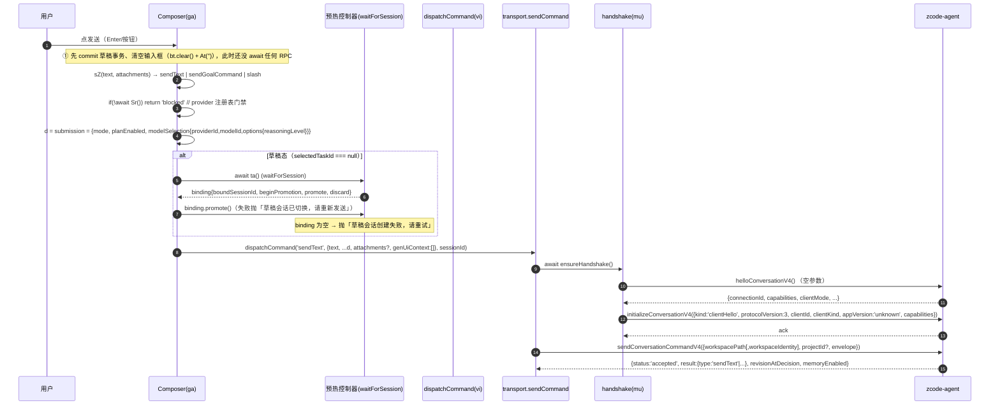

# 03 · 新对话创建 / 首条消息发送链路审计（3.16.1 → 3.17.1）

> 审计对象：`Reference_web/3.16.1`、`Reference_web/3.17.1` 网页快照（**只读、未执行任何快照 JS**）、
> 桌面 asar 未涉及（本条链路全在前端 bundle 内），以及本仓 `rust/`、`android/` 现状。
> 结论按「已证 / UNVERIFIED」分开写，不猜。

---

## 0. 结论速览

1. **3.17.1 的「新对话」不是一条 RPC，而是「先预热建会话、再按会话发消息」两步。**
   进入草稿页（`sessionId === null`）就会自动发一条 **`createSession{workspaceId[, config]}`**（无任何消息内容）；
   用户点发送后发的是 **`sendText{text, mode, planEnabled, modelSelection, ...}`**，`sessionId` 用预热拿到的那个。
   首条消息**不**随 `createSession` 提交（`firstInput` 只在「崩溃恢复重放」与「保存的工作流升级」两条旁路出现）。

2. **`createSession` 是 `sendConversationCommandV4` 里的一个命令 `type`，不是独立方法。**
   全程只有 4 个 RPC：`helloConversationV4()` → `initializeConversationV4(clientHello)` →
   `sendConversationCommandV4({workspacePath[,workspaceIdentity], envelope})` → `subscribeConversationV4`。
   频道固定 `zcode-agent`（`Channels.zcodeAgent`）。

3. **`workspaceId` ≠ `workspacePath` 不是可互换的两个名字**：`createSession.payload.workspaceId` 取的是
   **`workspaceKey = workspaceIdentity?.trim() || workspacePath`**（`Kn=u?.trim()||l`），
   `sendConversationCommandV4` 的外层 scope 同时带 `workspacePath` 与（可选）`workspaceIdentity`。

4. **关键负面结论：这条链路的语义在 3.16.1 与 3.17.1 之间几乎逐字相同。**
   草稿预热（`v4-draft-prewarm`）、`waitForSession → beginPromotion → sendText`、
   「点发送先清空输入框再 await」这三处都是两版共有。**因此真机现象不能归因于网页侧改版**，
   只能落在 Android ↔ Rust 的接线差异上（§6、§8）。3.17.1 确实新增的差异见 §5。

5. **Android 侧已定位到 5 个可验证缺陷**（§6 H1–H5），其中 H1（`state.workspaceId` 从未赋值、回退链仍可能为
   null 且**早退早于任何 RPC**）与 H5（`EngineChatOps` 用 `engine.bridgeSession.value` 而不是注册表 handle 的 bridge，
   导致同一工作区开出第二个 transport → 第二次 `helloConversationV4` 抢不到应答）能**单独**造成
   「输入框清空 + 无消息 + 看不到 createSession」。

---

## 1. 3.17.1 新对话完整链路

### 1.1 入口（点击 → 草稿态）

```
侧栏「新建任务」/ 空态「开始对话」/ 快捷键 newTask
  └─ Root: startNewTaskFromActiveWorkspace
       ├─ projectService.prepareSession({projectId?, hostId?, draftId?, reuseDraft?})   ← 只为拿真实 workspacePath/identity 与 draftId
       └─ startDraftInWorkspace(workspacePath, workspaceIdentity, {provider?, draftId?, projectId?})
            └─ zustand: ZO.getState().setDraftFocusVersion(...) / draftProjectId / draftTaskGroupId / draftCreateSource
                 └─ 面板 <I4 paneId sessionId={null} …> 重新渲染（草稿态）
```

- 草稿不是路由对象、也不是持久化会话：它就是 **`sessionId === null` 的同一个聊天面板**。
  证据：`function I4({paneId:e,sessionId:t,...})`（panel 组件）里所有草稿分支都写 `t===null`；
  作用域串是 ``qn=`${Kn}\u0000${t??``}```，即 `workspaceKey\0sessionId`，草稿时后缀为空。
- 草稿相关状态全在 `getWorkspaceState(workspacePath, workspaceIdentity)` 里：
  `draftId / draftProjectId / draftTaskGroupId / draftCreateSource / draftFocusVersion / composerTextInsertRequest / draftRuntimeInvalidationVersion`。
- 草稿输入框 placeholder = `chat.placeholder.newTask`（移动端 `chat.placeholder.newTaskMobile`），
  由 `i4t({compactNewTask, hasHistoryMessages, isTaskProcessing})` 选择。
  **3.17.1 的 zh-CN 词表里没有「这个对话还没有内容」这句话**（`IntlProvider` 全文检索无 `还没有内容`）；
  草稿态文案是 `chat.empty.title=开始对话` / `chat.empty.description=开始在 {workspace} 项目新建任务`。

### 1.2 草稿预热：进页面就 `createSession`

```
<I4 sessionId=null>
  └─ {binding, waitForSession} = zKt({enabled: t===null && wr && !Re, workspaceKey: Kn, paneId, transportIdentity, dispatchCommand: vi, resolveInitialConfig: Ar})
       wr = (agentStartupAllowed=qKt(...)) && fe(=M8e rpcReady)
       Re = 持久化的「首条未决命令」重放记录（sM(Pe) 命中时非空，用于崩溃恢复）
  └─ FKt.acquire() → reconcile() → startCurrent(invalidationVersion)
       └─ NKt({workspaceKey, dispatchCommand, onReady, onSettled, resolveInitialConfig})
            payload = { workspaceId: workspaceKey }            // 只有 workspaceId
                      + config: resolveInitialDraftConfig()    // 仅当草稿 config 非空
            dispatchCommand(`createSession`, payload, /*sessionId*/ null)
              ├─ 成功 accepted + result.type==='createSession' → onReady(result.sessionId)  → 「draft session 预热就绪」
              ├─ 被拒 → warn `[v4-draft-prewarm] createSession 被拒`，binding 保持 null
              └─ 抛错 → warn `[v4-draft-prewarm] createSession 失败`
            finally → onSettled() → completion resolve → 若 binding 仍为空则 scheduleRetryAfterFailure
       retry 退避：PKt=[500,1000,2000] ms（最多 3 次补试）
  └─ dispose 时（离开草稿/换 workspace）：若仍处 draft 状态 → dispatchCommand(`deleteSession`, {}, sessionId) 回收
```

预热控制器 `FKt` 是**按 `(transportIdentity, workspaceKey, paneId)` 复用**的单例（`IKt: Map`），
`cleanupTimer` 在最后一个订阅者离开后用 0ms 定时 retire；空闲 30s 后连接层才真正回收（见 §1.5）。

### 1.3 点「发送」→ 首条消息真正下发

`ChatScreen` 的发送按钮 → `ga()`（内部 `vi` = dispatchCommand）→ 完整时序：



要点（全部来自代码，不是推测）：

| # | 事实 | 影响 |
|---|---|---|
| 1 | 清空输入框发生在 `await` 之前：`U(), i===\`startNow\` && (bt.current?.clear(), At(\`\`), ...)` | 任何后续失败/挂起都会表现为「字没了、消息没来」 |
| 2 | 首条消息的 `sessionId` = 预热的 `x.sessionId`（不是新发一次 createSession） | 预热失败 ⇒ 根本没有会话，也不会补发 createSession |
| 3 | 提交串行化：`tr.enqueue(() => ga(...))`（单生产者队列） | 连点不会并发建会话，但也不会重试 |
| 4 | `dispatchCommand` 入口 `if(!fe) throw UT()`（`fe` = rpcReady） | 「remote-waiting」态下**静默抛错**，不会发任何 RPC |
| 5 | 每条命令都 `await a()`（= `mu(service)`）先握手 | 握手挂住 = 所有命令一个字节都发不出去 |

### 1.4 失败面（用户能看到什么）

| 失败点 | 表现 | 证据 |
|---|---|---|
| 预热被拒 | 无提示；3 次退避重试；仍失败则发送时抛 `草稿会话创建失败，请重试` | `草稿会话创建失败，请重试` |
| 预热中换了 workspace | 抛 `草稿会话已切换，请重新发送` | 同处 |
| `sendText` 被拒 | 抛 `w.reasonCode ?? 'sendText 被拒绝'` | `sendText 被拒绝` |
| transport 异常 | 写入 composer 错误条 `chat.error.sendFailed`（`$t({code: GT(e) ?? 'SEND_FAILED'})`） | `chat.error.sendFailed` |
| 卡在握手/通道 | **什么都没有**：无错误条、无行、输入框已空 | 由 #1 + `await a()` 推出 |
| 崩溃后重开 | `sM(Pe)` 读 localStorage 的未决首条命令 → 用户确认后 `replay`（唯一走 `createSession + firstInput` 的正常 UI 路径） | `v4-pending-command` 日志、`consumeReplay` |

### 1.5 连接复用（网页/桌面）

- 连接注册表 `Qu(scope, agentService, createLocalMediaPreviewUrl)`，key =
  ``Hue(scope) = `${remoteSessionId ?? '__base__'} ${workspaceIdentity?.trim() || workspacePath}` ``。
- 复用条件：`i && (i.agentService === t || isRemote)`；命中的是**同一个 `{layer, transport, agentService}` 条目**，
  `refCount += 1`，取消 keep-warm 定时器，日志 `v4 workspace connection reused`。
- 未命中：旧条目 `stale = true`，`refCount <= 0` 时立刻 `dispose`；新建一条。
- 释放：`refCount -> 0` 时启动 **30s keep-warm**（`Vue=3e4`），到期才 `layer.dispose()`（`v4 workspace connection keep-warm expired`）。
- 握手 `mu(service)` 用 **`WeakMap` 按 service 对象去重**：同一 service 并发调用共享同一个 promise；
  失败才删除（允许重试）。所以「同一 bridge」= 「同一 handshake」，**跨 bridge 不去重**。

---

## 2. 参数表

### 2.1 信封（`fu(type, payload, sessionId, baseRevision, baseLogEpoch)`）

```jsonc
{
  "commandId": "<uuid 字符串>",
  "clientId": "client-<uuid>",          // localStorage `zcode-v4-client-id:v1`
  "sessionId": null,                    // createSession 时为 null，但键存在（序列化时省略 undefined）
  "baseRevision": 12,                   // 仅 CAS 命令
  "baseLogEpoch": "…",                  // 仅 row-target 命令
  "type": "createSession" | "sendText" | …,
  "payload": { … },
  "issuedAt": 1730000000000
}
```

> 3.17.1 特有：`type === 'createSession'` 时 **payload 会补一个客户端 sessionId**：
> `payload.sessionId ??= 'sess_<crypto.randomUUID()>'`（`sess_${crypto.randomUUID()}`）。
> Rust 侧当前不补（§5 D2）。

### 2.2 `createSession` payload

| 键 | 预热路径（自动） | 首条消息路径（恢复/工作流） | Rust `create_session_payload` |
|---|---|---|---|
| `workspaceId` | ✅ `workspaceIdentity?.trim()\|\|workspacePath` | ✅ 同 | ✅ `workspaceId` 实参 |
| `config` | 有则带（草稿初始 config） | — | ✅ `config` |
| `firstInput` | ❌ 不带 | ✅ `{text[, modelSelection][, mode]}`（`planEnabled` 亦可） | ✅ 由 `firstText` 生成 `{text[,attachments]}` |
| `sessionId` | ✅ 自动 `sess_<uuid>`（3.17.1 新增） | ✅ 同 | ❌ 无 |
| `runtimeModel` / `mcpServers` | ❌ | ❌ | ✅（Dart 遗留） |

### 2.3 `sendText` payload（首条与后续同形）

```jsonc
{
  "text": "…",
  "mode": "build" | "edit" | "yolo" | "guarded",   // 注意：plan 被归一化成 build + planEnabled
  "planEnabled": false,
  "modelSelection": { "providerId": "…", "modelId": "…", "options": { "reasoningLevel": "…" } },
  "attachments": [ … ],                  // 有附件才有
  "genUiContext": [],                    // 恒为空数组（composer 显式置空）
  "conversationQuotes": [ … ],           // 引用消息
  "requestedDelivery": "auto|startNow|queue|guide",
  "heldQueueDisposition": "clearQueueAndSend|keepQueueAndSend",
  "expectedHeldQueueItemIds": [ … ],
  "context_refs": [ { "kind": "shared_context_import", "context_id": "…" } ],
  "source": { "kind": "pluginUi"|"genUi", … }
}
```

`mode/planEnabled/modelSelection` 来自 `qM()` 冻结的 submission：
`{mode: plan?'build':mode, planEnabled, modelSelection:{providerId, modelId, options:{reasoningLevel}}}`。
**这三个键是「首条消息带上用户选的模型/模式」的唯一载体**，缺失就只能吃工作区默认模型。

### 2.4 握手

| RPC | 参数 | 应答中前端真正读的字段 |
|---|---|---|
| `helloConversationV4` | 无（Rust 侧发 `[]`） | `connectionId`（Rust 必需）、`capabilities.historyFirst`、`capabilities.workflowRunDeltas`、`clientMode`；整体过 zod 校验 |
| `initializeConversationV4` | `{kind:'clientHello', protocolVersion:3, clientId, clientKind:'desktop'|'web', appVersion:'unknown', capabilities:{workspaceHookReviewUi:true, historyFirst?, workflowRunDeltas?}}` | 无（只看是否抛错） |

> Rust 侧 `ClientHello` 是 `kind/protocolVersion/clientId/clientKind:'mobileApp'/appVersion:'3.6.5'`，
> **没有 `capabilities` 字段**（§5 D3）。

---

## 3. `workspaceId` 三兄弟

| 名字 | 出现在哪 | 取值 |
|---|---|---|
| `workspacePath` | `sendConversationCommandV4` 外层 scope；`conversation_open.scope` | 真实磁盘路径（对端当 agent CLI 的 spawn cwd） |
| `workspaceIdentity` | 同上，**有值才出现** | 远程/虚拟工作区标识；本地工作区通常缺席 |
| `workspaceKey` | 前端本地概念（`Kn`） | `workspaceIdentity?.trim() \|\| workspacePath`（只 trim identity） |
| `workspaceId` | **仅** `createSession.payload` 与 sessions-index 里的 id | 预热时直接塞 `workspaceKey`；服务端一般回 `workspaceId === workspacePath`（Android 侧注释已注记） |
| `workspaceIdentity`（host 侧） | `resolveSessionDirectories` / project 服务 | 与上面同义，另可派生出 `hostId` |

`createSession` **不需要先握手之外的任何前置**：`commandId` 客户端生成，`payload.sessionId` 客户端生成；
`result.sessionId` 是服务端最终权威（Rust 侧 `parse_create_session_result` 也是读它）。

---

## 4. 3.16.1 → 3.17.1 diff（按「对这条链路有影响」排序）

| # | 项 | 3.16.1 | 3.17.1 | 影响 |
|---|---|---|---|---|
| D1 | 草稿预热 | 有（`v4-draft-prewarm`，payload `{workspaceId[,config]}`，同样 `PKt=[500,1e3,2e3]`） | **同** | 无（不是回归点） |
| D2 | 提交路径 | `await Wi()` → `beginPromotion` → `dispatchCommand('sendText')`，清空输入框在 await 前 | **同**（仅变量改名） | 无 |
| D3 | `createSession` payload 的 `sessionId` | 无 | `sess_${crypto.randomUUID()}` | 服务端若依赖该字段（未验证）则语义变化 |
| D4 | `hello` 能力协商 | `{historyFirst?, independentPlanState?}` | 增加 `genUiContext/sessionDirectorySource/sessionWorkspaceRouting/residentRowsRange` + `hostCapabilities{sessionDirectorySource}`；客户端上报 `workspaceHookReviewUi` + `workflowRunDeltas` | `sendText.genUiContext` 非空且能力缺失会直接抛 `proto.genUiContextUnsupported` |
| D5 | `sendCommand` 校验 | 有 `independentPlanUnsupported` | 另加 `genUiContextUnsupported`；E2E 延迟钩子 `__zcodeTransportDelayE2E`（仅测试） | 低 |
| D6 | `workspace-bridge-open` | `{requestId, bridgeSessionId, bridgeGeneration[,recoveryId], workspaceKey, taskId?, taskHostId?, fileTreeTaskId?, project?}` | 追加 **`terminalClientSessionId`**，且**开新桥前 `C?.abort()` 掉上一条** | 两个面板各自开桥时，后开会打断前一条（`Web remote control version changed before the workspace bridge was ready.`） |
| D7 | 运行时重启后的草稿重建 | 无独立状态机 | `GKt`：`runtimeRestart → epoch+1 → invalidateDraftRuntime`，**5s 超时**后 `rebuildTimeout` | 预热可能被作废，依赖 `waitForSession` 再次建会话 |
| D8 | 首条未决命令恢复 | 有 `consumeReplay`（`createSession+firstInput` 重放） | 同，且新增 `sessionCreateSource / taskGroupId / draftId` 进 clientContext，并拒绝跨 workspace 重放 | 恢复路径参数更严 |
| D9 | `projectId / resolveSessionDirectories` | 有 | 同 | 无 |
| D10 | bundle 规模 | 6,836,503 B / validation 331,153 B | 6,986,617 B / 348,943 B | +2.2% / +5.4% |

**明确结论：D1/D2（新对话的两条主路径）两版逐字等价。** 因此「3.17.1 上不行、3.16.1 上行」若成立，
差异只能来自 D3/D4/D6/D7 这类**外围**变化，或干脆不来自网页侧（见 §6）。

---

## 5. Rust 实现现状 vs 3.17.1 参考

Rust 是 `Reference_code/lib/protocol/conversation.dart`（Dart 桌面/mobile 客户端）的移植，**不是** web bundle 的移植。
两者在「同一条 wire 协议」上一致，但 op 面与字段有实质差异。

| # | 主题 | 3.17.1 参考 | 本仓 Rust | 判定 |
|---|---|---|---|---|
| D1 | 命令下发入口 | `sendConversationCommandV4({…scope, envelope})` | `op` 透传：`sendText` / `createSession` / …（`ConversationTransport::OPS` 41 项，**不含** `helloConversationV4`/`initializeConversationV4`/`sendConversationCommandV4`） | 结构不同、线协议相同 |
| D2 | `createSession` 参数 | `{workspaceId, config?, firstInput?, sessionId?}` | 入参 `{workspaceId, firstText, attachments?, config?, runtimeModel?, mcpServers?, timeoutSecs?}` → payload `{workspaceId, firstInput:{text,attachments?}, config?, runtimeModel?, mcpServers?}`；**不写 `sessionId`** | 参数名/字段缺 `sessionId` |
| D3 | `initialize` | 带 `capabilities`，`clientKind: desktop|web` | `ClientHello{kind,protocolVersion:3,clientId,clientKind:'mobileApp',appVersion:'3.6.5'}`，**无 capabilities** | 协商面缺失 |
| D4 | `sendText` payload | `text, mode, planEnabled, modelSelection, attachments, genUiContext, conversationQuotes, context_refs, requestedDelivery, heldQueueDisposition, expectedHeldQueueItemIds, source` | `send_text_payload` 只有 `text, attachments, heldQueueDisposition, expectedHeldQueueItemIds, automationId, offPeakTaskId, offPeakRunType, botDeliveryTarget, toolDisallowlist` | **缺 mode/planEnabled/modelSelection/conversationQuotes/context_refs/source/genUiContext** |
| D5 | 握手前置 | 每条命令前 `await handshake` | 每条 flow 起始 `FlowStage::AwaitHandshake`；`pump()` 见到就自动挂 `#handshake` flow（`helloConversationV4` 空参 → `initializeConversationV4`） | 一致 |
| D6 | 超时 | 命令默认 30s；`createSession` 90s（Dart 常量） | `COMMAND_DEFAULT_TIMEOUT_SECS=30`、`CREATE_SESSION_TIMEOUT_SECS=90`；但 **Kotlin 只认 `args.timeoutSecs`**，不传就按 30s+5s 兜底 → createSession 实际 35s 就判死 | **宿主与核心超时不齐** |
| D7 | 连接复用 | 30s keep-warm + refCount | `Layer::open` 在同一 bridge 上按 key `putIfAbsent`；**跨 bridge 不共享**；`ConversationRegistry` 按 workspaceKey 缓存 `{bridge,key}` | 跨 bridge 无保护 |
| D8 | 首条消息会话化 | 预热 `createSession` + `sendText` | 无预热：`createConversation` 直接 `createSession(workspaceId, firstText)`（有附件时建会话再 `sendText`） | **Android 少了「预热」这一层**，语义上等价但少了「提前建会话」 |

---

## 6. 真机现象定位（输入框清空 / 消息不出现 / `createSession` 从未发出）

现象拆成三个可独立观测的事实：
(a) 输入框被清空 → 说明 `sending === false` 时按钮可点，且 `onSend` 执行到了清空那行；
(b) 消息行没出现；
(c) 看不到 `createSession` 的 RPC。

Android 侧代码（`ChatScreen.kt:243`、`ChatViewModel.kt:371/615`）给出的**唯一清空点**：

```kotlin
onSend = {
    val text = input.trim()
    if (text.isNotEmpty() || state.attachments.isNotEmpty()) {
        onSend(text)      // → ChatViewModel.sendText
        input = ""        // 无条件清空，不等任何结果
    }
}
```

`canSend = (value.isNotBlank() || attachments.isNotEmpty()) && !sending && !uploading`（`ChatScreen.kt:929`），
所以「能清空」反证点击时 `sending == false`，即 `sendText()` 确实跑进去了。之后四种分支：

| 假设 | 路径 | 是否发出 RPC | 用户可见 | 判别证据 |
|---|---|---|---|---|
| **H1** `workspaceId` 回退链全空 | `createConversation` 首段 `workspaceId == null` → `error = "工作区还没就绪，请稍后再试"`，**直接 return** | **否** | 输入框已空；理论上错误条应出现 | `grep` 全仓：`workspaceId` 只在 `ChatUiState` 声明（`ChatViewModel.kt:197`）与使用处（:624）出现，**从未被赋值**（sessions-index 首帧没写回）；若 `selectedWorkspace==null`（bootstrap 未完成）且 `selectedWorkspaceKey==null`（路由未带），即命中 |
| **H2** `selectedTaskId` 非空 | `sendText` 走分支 1（不是新对话）→ `chatOps.call("sendText", {sessionId, text})` | 发的是 `sendText`，**本来就没有 createSession** | 输入框空、消息可能投给了一个没人订阅的旧会话 | 新对话入口是否把 `taskId` 传成 `null`（`Route.Chat(taskId)`）；若从 Home 列表带着 taskId 进「新对话」即命中 |
| **H3** `ChatOps.call` 前置失败 | `ensureConversation`：`session() == null` → `invalidState("还没有桥会话…")` | **否** | 错误条「先打开一个工作区再发对话操作」 | 该分支 throw 前有 `sending=true`，但 `finally` 会复位；`bridgeSession.value` 为 null 时可复现 |
| **H4** `conversation_open` 卡住 | `EngineChatOps` 的 `mutex` + `engine.conversationOpen(...)`；Rust `Layer::open` = `client.conversation()`（`putIfAbsent`）+ 立刻补一条 `completed`，**正常不会卡** | 否（卡在 open） | 输入框空、无消息、**无错误条**（最多 5s 兜底后 timeout） | 需要真机日志：`conversation_open` 之后有无 `conversation_opened` |
| **H5** Rust 侧 transport 卡在 `AwaitHandshake` | `conversation_call{op:"createSession"}` 已被 FFI 接收（宿主看得到），但 `pump()` 先发 `helloConversationV4`；同一连接上若已有另一条 transport 在握手（Home 的 bridge），对端只回一个 → 这条永远等 | **无线上的 `sendText`/`createSession` 命令帧**（只有 `helloConversationV4`） | 输入框空、无消息；35s 后宿主 timeout 才报错 | 这正是 `ConversationRegistry` 注释自述的现象：「对端的 `helloConversationV4` 是单连接语义，多个工作区并发握手只会回一个」。**`EngineChatOps` 用的是 `engine.bridgeSession.value`（当前值）而非注册表 handle 的 bridge/key**，一旦两者不同就会为同一 workspace 再开一条 transport |

### 判定（按可证程度排序）

- **可证（读码即可）**：
  - H1 的「`workspaceId` 从不赋值」是硬缺陷；但它单独发生时**应有错误条**，与「什么都没发生」不完全吻合，
    除非错误条被 `dismissError`/后续 `sending=true` 分支覆盖、或用户未注意。
  - H5 的架构缺陷是硬缺陷：`ChatOps` 与 `ConversationRegistry` 是**两套独立的会话缓存**，
    前者用全局 `bridgeSession.value`，后者按 workspaceKey 缓存 bridge；二者不一致时必然重复 `conversation_open`
    → 重复 transport → 重复握手 → 抢应答。
- **需真机日志才能定案**：H2 / H4 / H5 三者的区分点见下表（**UNVERIFIED**，未拿到设备日志）。

| 观测点 | H1 | H2 | H4 | H5 |
|---|---|---|---|---|
| `logcat` 有 `conversation_open` | 无 | 无 | 有（可能不返回） | 有 |
| 有 `conversation_call op=createSession` | 无 | 无（op=sendText） | 无 | **有** |
| 有 `conversation_call op=sendText` | 无 | 有 | 无 | 无 |
| relay 帧里有 `helloConversationV4` | 无 | 无 | 无 | **有** |
| relay 帧里有 `sendConversationCommandV4` | 无 | 无 | 无 | **无** |
| 有无错误条 | 有（工作区未就绪） | 无 | 5s 后 timeout | 35s 后 timeout |

> 结论措辞：**「createSession 从未发出」这一观测在 H1/H5 下都成立**；H5 更能同时解释「输入框已清空、
> 无任何提示、且此前 Home 页面已经连上同一工作区」这一组合。建议先按 §8 的 P0 两条修，再复测。

---

## 7. 证据索引（文件 + 字节偏移 + 原文）

> 偏移为 **UTF-8 字节偏移**（`Buffer.byteLength` 计算），定位串为原文片段，可直接 `indexOf` 复核。
> 3.17.1 主 bundle：`Reference_web/3.17.1/assets/index-Dwhx77cK.js`（6,986,617 B）
> 3.16.1 主 bundle：`Reference_web/3.16.1/assets/index-DbEHT6Gg.js`（6,836,503 B）

| # | 偏移 | 原文（截断） | 说明 |
|---|---|---|---|
| E1 | 4,751,148 | `function I4({paneId:e,sessionId:t,openTrigger:n,rootSessionId:r,readOnly:…` | 聊天面板组件；`sessionId===null` 即草稿 |
| E2 | 4,760,685 | `Kn=u?.trim()||l,qn=` + `` `${Kn}\u0000${t??``}` `` | workspaceKey 定义 |
| E3 | 2,970,598 | `function NKt(e){let{workspaceKey:t,dispatchCommand:n,onReady:r,onSettled:i,resolveInitialConfig:a}=e…` | 预热控制器：发 `createSession` |
| E4 | 2,970,940 | ``u=()=>{let e={workspaceId:t},n=a?.();return n&&Object.keys(n).length>0&&(e.config=n),e}`` | 预热 payload 仅 `workspaceId(+config)` |
| E5 | 2,970,811 | ``[v4-draft-prewarm] 清理预热会话被拒`` | dispose 时 `deleteSession` 回收 |
| E6 | 2,971,365 | ``[v4-draft-prewarm] draft session 预热就绪`` | 预热成功 |
| E7 | 2,971,749 | `var PKt=[500,1e3,2e3]` | 预热失败退避 |
| E8 | 2,972,776 | ``if(!r.binding)throw Error(`草稿会话创建失败，请重试`)`` | 预热失败在发送时报错 |
| E9 | 4,783,632 | `zKt({enabled:t===null&&wr&&!Re,workspaceKey:Kn,paneId:e,invalidationVe…` | 预热启用条件 |
| E10 | 4,791,335 | ``w=await c(`sendText`,{text:e,...d,...n?.requestedDelivery?…`` | 首条消息 = sendText（带 submission） |
| E11 | 3,501,746 | ``U(),i===`startNow`&&(bt.current?.clear(),At(``),k=mt.current,V=!0)`` | **await 之前就清空输入框** |
| E12 | 247,785 | `var pu=new WeakMap;function mu(e){let t=e,n=pu.get(t);if(n)return n;…` | 握手按 service 去重 |
| E13 | 247,867 | `Aee.parse(await e.helloConversationV4())` | hello 应答过 zod |
| E14 | 248,048 | ``initializeConversationV4({kind:`clientHello`,protocolVersion:3,clientId:Nle(),clientKind:…`` | 握手第二步 |
| E15 | 247,513 | `sessionId:e.payload.sessionId??` + `` `sess_${crypto.randomUUID()}` `` | 3.17.1 给 createSession 补 sessionId |
| E16 | 1,994,945 | `function qM(e,t){…return Object.freeze({mode:…,planEnabled:…,modelSelection:…})` | submission 形状 |
| E17 | 313,908 | `function Qu(e,t,n){let r=Hue(e),i=Zu.get(r)…` | 连接注册表：按 key 复用 |
| E18 | 312,691 | ``Zu=new Map,Bue=`__base__`,Vue=3e4`` | 30s keep-warm |
| E19 | 6,975,134 | ``{zcode_type:`workspace-bridge-open`,terminalClientSessionId:r,…`` | 3.17.1 新增字段 |
| E20 | 6,975,028 | `C?.abort();let a=new AbortController;C=a;let o=()=>!c&&!v.isBlocked()&&i===h` | 3.17.1 开新桥前 abort 旧桥 |
| E21 | 2,862,182（3.16.1） | ``[v4-draft-prewarm] 清理预热会话被拒``（3.16.1 同构） | **预热两版都有** |
| E22 | 4,683,124（3.16.1） | `let x=t===null?await Wi():null;if(x&&(await qi.current(x.sessionId),!x…` | 3.16.1 提交路径同形 |
| E23 | 3,380,862（3.16.1） | ``re(),a===`startNow`&&(lt.current?.clear(),yt(``),k=it.current,te=!0)`` | 3.16.1 同样「先清空」 |
| E24 | 6,824,992（3.16.1） | ``{zcode_type:`workspace-bridge-open`,requestId:Z9(`workspace-bridge`),bridge…`` | 3.16.1 无 `terminalClientSessionId`、无 abort |

Rust / Kotlin 侧（行号为 1-based）：

| # | 文件:行 | 内容 |
|---|---|---|
| R1 | `rust/crates/protocol/src/conversation_transport.rs:945-1000` | `OPS` 41 项清单（含 `createSession`，不含 3 个 web 方法名） |
| R2 | `…/conversation_transport.rs:1489-1516` | `"createSession" =>` 读 `workspaceId/firstText/attachments/config/runtimeModel/mcpServers/timeoutSecs`，`FlowStage::AwaitHandshake` |
| R3 | `…/conversation_transport.rs:1335-1357` | `"sendText" =>` 读 `sessionId/text/attachments/…`（无 mode/modelSelection） |
| R4 | `…/conversation_transport.rs:2444-2530` | `pump()`：无握手时自动插 `#handshake` flow；`advance_flow` 先发 `helloConversationV4`（空参，30s） |
| R5 | `rust/crates/protocol/src/conversation.rs:54-71` | `CONVERSATION_PROTOCOL_APP_VERSION="3.6.5"`、`clientKind="mobileApp"`、`COMMAND_DEFAULT_TIMEOUT_SECS=30`、`CREATE_SESSION_TIMEOUT_SECS=90` |
| R6 | `rust/crates/protocol/src/conversation.rs:319-354` | `create_session_payload`：`workspaceId` + `firstInput{text,attachments?}`，无 `sessionId` |
| R7 | `rust/crates/protocol/src/conversation.rs:358-412` | `send_text_payload`：缺 `mode/planEnabled/modelSelection/genUiContext/conversationQuotes/context_refs/source` |
| R8 | `rust/crates/protocol/src/conversation.rs:146-181` | `ClientHello` 无 `capabilities` |
| R9 | `rust/crates/ffi/src/conversation.rs:337-380` | `Layer::open`：`client.conversation()`（`putIfAbsent`）+ 立刻补 `completed`；同 key 不重复登记 |
| R10 | `rust/crates/protocol/src/zemote_client.rs:1546-1560` | `conversation()` 在**同一 bridge** 内按 key `putIfAbsent` |
| K1 | `android/.../ui/chat/ChatScreen.kt:243-250` | `onSend { onSend(text); input = "" }` —— 无条件清空 |
| K2 | `android/.../ui/chat/ChatScreen.kt:929` | `canSend = (isNotBlank||attachments) && !sending && !uploading` |
| K3 | `android/.../ui/chat/ChatViewModel.kt:371-390` | `sendText`：`selectedTaskId==null → createConversation`；`sending` 时静默 return |
| K4 | `android/.../ui/chat/ChatViewModel.kt:615-690` | `createConversation`：`workspaceId` 回退链为空 → **RPC 前早退** |
| K5 | `android/.../ui/chat/ChatViewModel.kt:197 / 624` | `workspaceId` 声明 / 唯一使用处 —— **全仓无赋值** |
| K6 | `android/.../ui/chat/ChatOps.kt:90-170` | `EngineChatOps`：`session = { engine.bridgeSession.value }`，自建 `opened` 缓存 |
| K7 | `android/.../ui/chat/ConversationRegistry.kt:79-87` | 注释自述「`helloConversationV4` 是单连接语义，多个工作区并发握手只会回一个」 |
| K8 | `android/.../engine/ZemoteEngine.kt:685-700` | `hostTimeoutMs` 只认 `args.timeoutSecs`，默认 30s+5s |

---

## 8. UNVERIFIED 清单

1. **UNVERIFIED** — 真机日志未取：无法在 H1/H2/H4/H5 之间定案（判别表见 §6）。
2. **UNVERIFIED** — 3.17.1 的 `payload.sessionId = sess_<uuid>` 是否被服务端采用/校验；Rust 不发送它是否等价。
3. **UNVERIFIED** — hello 应答的 zod schema（导出名 `T` → 本地 `ox`）是否 `.strict()`：
   若严格，Rust/对端多返回任何未知键都会让**整个握手失败**，而失败点在 `mu()` 内、表现为「一条 RPC 都没发」。
4. **UNVERIFIED** — 对端 `helloConversationV4` 「单连接语义只回一个」的确切条件（是否按 connection 还是按 client？），
   本仓只在 `ConversationRegistry` 注释里断言。
5. **UNVERIFIED** — `resolveInitialDraftConfig()` 返回的 `config` 精确键集（从调用点看是草稿 config map：
   `mode/planEnabled/modelSelection?` 一类，但未逐键确认）。
6. **UNVERIFIED** — Android 新对话路由是否传 `taskId=null`（影响 H2）。
7. **UNVERIFIED** — `sM()` 读取的 localStorage 未决命令在 Android 上是否实现（Android 目前无对应恢复机制，
   崩溃后首条消息会丢）。

---

## 9. 对 Android 的具体修复建议

按「先止血、再对齐参考」排序。P0 两条不依赖真机日志，值得直接修。

### P0-1 让 `workspaceId` 真的有值，并禁止「无 RPC 早退」

- `ChatUiState.workspaceId` 目前是死字段。在 sessions-index 首帧（`sessionsIndex` 快照里 `workspaceId` 字段）
  写回 `_state.workspaceId`；同时把 `createConversation` 的回退链改成
  `workspaceId ?: selectedWorkspace?.identity?.trim() ?: selectedWorkspace?.path ?: selectedWorkspaceKey`，
  与前端 `Kn = workspaceIdentity?.trim() || workspacePath` **完全一致**（顺序也一致，identity 优先）。
- `createConversation` 的早退分支必须**把文本还给输入框**（或至少不静默）：`error` 之外再暴露
  `ChatUiState.pendingText`，由 `ChatScreen` 在 `error != null && !sending` 时回填 `input`。
  参考实现之所以敢「先清空」，是因为它**一定**有一条可恢复记录（`sM` 未决命令 + 错误条 + 重放按钮）；
  Android 缺这一层，就不能无条件清空。

### P0-2 对话层只用注册表的 handle，不再用「当前桥」

- `EngineChatOps` 的 `session = { engine.bridgeSession.value }` 是 H5 的直接成因。
  改成注入 `ConversationRegistry`，`ensureConversation(scope)` 里先
  `registry.ensure(workspaceKey, taskId, scope)` 拿 `{bridge, key}`，再
  `engine.conversationCall(bridge, key, op, args)`；`opened/openedScopeKey` 缓存删除（注册表已经是权威缓存）。
- 同时把 `ChatViewModel.subscribeConversation` 的 `_state.bridgeSession ?: engine.bridgeSession.value`
  也换成注册表 handle 的 `bridge`（同一个坑）。
- 收益：同一 workspace 全程只有 **1 个 bridge、1 个 conversation key、1 次握手**，
  与参考实现「`Qu` 按 key 复用 + `mu` 按 service 去重」的语义对齐。

### P1-1 补齐 `sendText` 的模型/模式字段

`sendText` 必须能带 `mode / planEnabled / modelSelection{providerId,modelId,options{reasoningLevel}}`
（参考实现把它当「首条消息用哪个模型」的唯一载体）。当前 `send_text_payload` 没有这三键，
表现会是「建了会话但用工作区默认模型跑」。建议在 `send_text_payload` 增加三个可选参数并透传，
`ChatViewModel` 从 `state.config` 取（`plan` 归一化成 `build` + `planEnabled:true`）。

### P1-2 对齐 `createSession` 的参数与超时

- 支持 `timeoutSecs`：Android `createConversation` 显式传 `timeoutSecs: 90`，否则宿主 30s+5s 就判超时
  （核心给的是 90s，宿主先失败会把长操作误判成失败）。
- 支持 `config`（草稿模型的 provider/model/mode），这样会话创建即带模型，而不是等首条 `sendText`。
- 评估是否需要在 payload 里补客户端 `sessionId = sess_<uuid>`（待 UNVERIFIED #2 结论）。

### P1-3 复刻「预热」语义（可选但推荐）

参考实现是「进草稿页就 createSession，点发送只发 sendText」；Android 现在是「点发送才 createSession」。
两者的**可见差异**是：参考实现在用户打字期间就把会话建好，首条消息只需一次 `sendText`，
因而「首条消息丢失」只能发生在 `sendText` 上、有明确的 `accepted/rejected`。
若要复刻，注意三件事：预热失败要按 `[500,1000,2000]` 重试；离开草稿页要 `deleteSession` 回收；
预热与首条 `sendText` 之间要 `promote` 语义（防止用户切换工作区后串会话）。

### P2 其它

- `ClientHello` 补 `capabilities`（至少 `workspaceHookReviewUi:true`，按需 `historyFirst`），
  与参考实现的协商面对齐；`clientKind` 建议改成 `'web'|'desktop'` 之外新增 `'mobileApp'` 时确认服务端白名单（UNVERIFIED）。
- `ChatScreen` 的 `onSend` 改成「发送成功后由状态驱动清空」：`ChatUiState` 增加 `lastSentText` +
  `consumeSubmittedText()`，或采用参考实现的「未决命令记录 + 失败回填」。
- 崩溃恢复：实现等价于 `sM()` 的未决首条命令持久化（`draftId/commandId/sessionId/workspacePath/submittedText`），
  重启后用 `createSession + firstInput` 重放。
- 去掉 `ChatViewModel.sendText` 里 `sending` 的静默 return，至少打日志/置错误，避免「点了没反应」无从排查。

---

## 附录 A · 关键函数速查（3.17.1 主 bundle）

| 函数 | 作用 |
|---|---|
| `I4` | 聊天面板组件；`sessionId===null` = 草稿 |
| `zKt` | 草稿预热的 React 绑定（`{binding, waitForSession}`） |
| `FKt` | 预热控制器（按 key 复用、退避重试、promote/discard） |
| `NKt` | 真正发 `createSession` 的 worker（含 `deleteSession` 回收） |
| `vi` | `dispatchCommand(type, payload, sessionId, baseRevision, baseLogEpoch, …)` |
| `ga` | 提交主流程（slash/附件/highspeed/预热 promote/sendText） |
| `_a` / `ya` | `ga` 的串行队列包装 / 面向上层的 `send` 入口（错误 → `chat.error.sendFailed`） |
| `fu` | 信封构造（createSession 自动补 sessionId） |
| `mu` | 握手（`helloConversationV4` + `initializeConversationV4`），WeakMap 去重 |
| `Iu` | 单 scope 的 transport（`sendCommand/subscribe/rowsRange/…`） |
| `Qu` | 连接注册表（refCount + 30s keep-warm + 按 key 复用） |
| `sM` | 读 localStorage 的未决首条命令（崩溃恢复） |
| `qM` | submission 构造（`mode/planEnabled/modelSelection`） |
